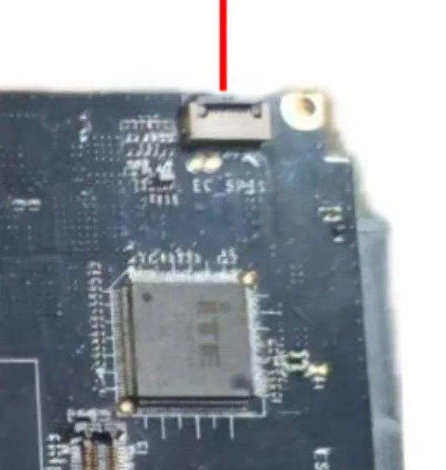

# X210AI — ITE IT5571 EC: guida completa (reverse engineering, patch, dump/flash)

Firmware EC di una scheda **X210AI** con chip **ITE IT5571 rev. 2**: eFlash embedded 128 KiB,
core **8051**, package **LQFP-128** con piedini (14×14 mm, passo 0,4 mm), quindi la variante
`IT5571E-128` e **non** la VFBGA. Package visto in foto (§16); il marking completo è da leggere sul chip.
Questa guida è l'unico documento del progetto: contiene analisi, patch, dump/flash e
recovery. I materiali originali stanno in `inputs/`, i tool in `tools/`, i dump in `dumps/`.

## Indice

1. [File e hash](#1-file-e-hash)
2. [Architettura e mappa memoria](#2-architettura-e-mappa-memoria)
3. [Firme e checksum (16B-signature)](#3-firme-e-checksum)
4. [Tastiera PS/2: scansione e conversione scancode](#4-tastiera-ps2)
5. [ISO / JIS: supporto nelle due versioni](#5-iso--jis)
6. [Patch: rimappatura tasti e swap Fn↔Ctrl](#6-patch-rimappatura-tasti-e-swap-fnctrl)
7. [Verifica delle patch (dimensione/logica)](#7-verifica-delle-patch)
8. [Dump e flash via software interno](#8-dump-e-flash-via-software-interno)
9. [Dump/flash hardware: XGecu T48 e CH341A (± mod 3.3V)](#9-dumpflash-hardware-t48-e-ch341a)
10. [Scrivere il chip EC "direttamente"?](#10-scrivere-il-chip-ec-direttamente)
11. [Database T48: ITE non supportato](#11-database-t48-ite-non-supportato)
12. [Livello Fn / ThinkLight (Fn+PgUp)](#12-livello-fn--thinklight)
13. [Se il flash dell'EC fallisce (brick) e recovery](#13-brick-e-recovery)
14. [Comprare il chip IT5571 da terze parti](#14-chip-di-ricambio)
15. [Strumenti e convenzioni](#15-strumenti-e-convenzioni)
16. [Porta di debug EC_SPI1](#16-porta-di-debug-ec_spi1)

---

## 1. File e hash

| File | SHA256 | Note |
|---|---|---|
| `dumps/EC0416.BIN` | `acaf8fed4b797f39d983849b916baaf61352832b337950fa9fb3225994cb6dca` | EC nuova X210AI, 131072 B, build `V0.3.2` 2025-04-15 18:20:35, md5 `7392fa5138c906ac17c7049fa69514e7` |
| `dumps/EC0416_ctrl-caps-swap.BIN` | `21f63a733dd5ee8b338ffefcda093ffec8d38c38138bc97c1e82a65a20acd406` | patch demo L-Ctrl↔CapsLock (2 byte) |
| `dumps/EC0416_fn-ctrl-swap.BIN` | `970431688f10aa160973d3f276c453e5cc86427a28a01ee34ef43ea17dfabee8` | patch Fn→LCtrl (1 byte) |
| `MTLH-NB06-ec-250322/MTLH-NB06_E03-250322.BIN` | md5 `4bbc1e54aad8cac51a3e0a5e5274ed28` | EC vecchia (build 2025-03-22, board MTLH-NB06) |
| `inputs/datasheets/IT5571E-128.pdf` | `a4e4afae8a157b7424401cf65c9dbecddce937b8b88a3dc1474124439bfc5753` | datasheet sintetico 29 pag |
| `inputs/datasheets/IT5570_A_V0.3.1_U.pdf` | `01666ebe44ece4a436b5ffaad40c9570c17f0b3480862caf224953585c59102f` | IT5570 V0.3.1 (parente stretto di IT5571, chip ID 0x5571≈IT8571) |
| `inputs/bios/X210AI0724BIOS.zip` | `2abe4276145b40d0e998d948e04223742b9efd05e434ef7d65fd56aab45e4d32` | Fpt.efi, UEFI shell, tutorial (`ifu.efi xx.bin 128` per EC) |

`/home/marco/bios_backup.rom` (12 MiB) = dump flash BIOS: **non contiene l'EC** (verificato: nessuna 16B-signature/stringa ITE).

## 2. Architettura e mappa memoria

- CPU **8051**; vettore reset `0x0000` → `LJMP 0x0070` (init: SP=0xC0, FPCFG `0x1001=0x3F`, copia tabelle XRAM, main `0x0400`). Vettori standard `0x03/0x0B/0x13/0x1B/0x23/0x2B`; interrupt estesi ITE: stub `LJMP 0x28xx` → dispatcher `0x2800`; trampoline "sw-interrupt" `0x2B6B–0x2BE0` (`MOV DPTR,#handler; AJMP 0x2800`).
- **4 banchi × 32 KiB**, finestra commutabile `0x8000-0xFFFF` (modulo Bank base xdata `0x1300h`; FLHCTRL2R `0x1032` scritto a `0x251E`). Mappa: banco0 `0x0000-0x54D4` (fisso) + firma testuale `0x7F80`; banco1 `0x8000-0xF8A4`; banco2 `0x10000-0x15515`; banco3 `0x18000-0x18132` (stub bank-switch); resto `0xFF`.
- Base registri (datasheet §3.2): SMFI `0x1000h` (FLHCTRL1R `0x1031`, ECINDAR `0x103B-0x103F`, protect P0BA `0x104F+`), INTC `0x1100h`, EC2I `0x1200h`, **Bank `0x1300h`**, Common `0x1400h`, PMC `0x1500h`, GPIO `0x1600h`, PS/2 `0x1700h`, WUC `0x1B00h`, KBS `0x1D00h`, BRAM `0x2200h`.
- Nel firmware: KBC host = xdata `0x004B/0x004C` (porte `0x64/0x60`); PD/UCSI in banco0 `0x3400-0x4300` (USB-C PD, controller esterno Analogix).

## 3. Firme e checksum

- **Nessuna firma crittografica e nessun checksum interno**: niente costanti SHA/RSA/MD5/CRC, somme non nulle, blocco `0x7F80` solo testo e non referenziato, reset `0x0070` non verifica la flash.
- L'unico "signature" è la **16B-signature a `0x40`** (`A5…A4 95 85 12 26 E6 AA 00 55 55`): marcatore di power-on per localizzare la code base (datasheet §6.4.3.11.1, formato "implicit" → base `0x000000`). **Va preservata intatta nelle patch** (offset validi `0x40-0xF0`).
- Protezione in scrittura: P0BA (SMFI) + PRx del descriptor — gestite da boot ROM/host, mai toccate dal firmware. Verifica con `flashrom --wp-list` / `fpt.efi`.
- Lato host la firma c'è solo sulla capsula BIOS Lenovo (.fl1), non sull'immagine EC.

## 4. Tastiera PS/2

- **KBS matrix 18×8** (base `0x1D00h`: KSOL/KSOH1/KSOCTRL/KSOH2/KSI@`0x1D04`/KSOxLSDR `0x1D10-0x1D21`). Driver scan in banco1 `0x9300-0x9F00`: loop 16 righe KSO, legge KSI, indice `0x4D=(col<<4)|row|0x08`.
- **Conversione scancode**: routine `0x0C09` (F0→break marker 0xFF, bit E7→casi speciali `0x83→0x41`/`0x84→0x54`, tabella `0x0D03`, break `\|0x80`) + tabella **set2→set1 `0x0D03`** (128 B). Estesi `0xE0`: tabella `0x305E`; sequenze multi-byte (Pausa `E1 14 77`): `0x25B2`; comandi PS/2: `0x2636`.
- KBC 8042 (IRQ1/IRQ12, A20G): init `0x0A76`, dispatcher eventi `0x0D9C` (flag bit `0x30-0x3D`), host I/O via `0x004B/0x004C`.
- Flusso: KBS scan → tabella matrice → scancode set2 → conversione set1 → buffer KBC → porta `0x60` + IRQ1.

## 5. ISO / JIS

- Matrice hardware 18×8 = 144 tasti (> ISO-105 e JIS-109); layout fisico = cablaggio tastiera.
- Tabella `0x0D03` copre tutti i set-2 `0x00-0x7F` incl. tasto extra ISO `0x61→0x56`; tasti E0 in `0x305E`.
- **Confronto old vs new (E03-250322 vs EC0416)**: tabella set2→set1 (`0x0D2C` vs `0x0D03`), matrice, ext, sequenze — **byte-identiche** → **ISO e JIS supportati in entrambe**. Se nella vecchia ù/<> non passavano all'OS, la causa è nel codice di scan/mappatura matrice di quella build (board MTLH-NB06), non nelle tabelle.

## 6. Patch: rimappatura tasti e swap Fn↔Ctrl

- **Livello scancode** (tasti host-visibili): tabella `0x0D03`. Demo: `dumps/EC0416_ctrl-caps-swap.BIN` (swap L-Ctrl `0x14`↔Caps `0x58`: byte `0x0D17`↔`0x0D5B`).
- **Fn↔Ctrl**: Fn è **fuori matrice** (pin dedicato, tipo T61 I/O18→GND — rif. github.com/thedalles77/USB_Laptop_Keyboard_Controller) e **non è uno scancode** → non si scambia via tabella; non c'è logica di swap né flag BIOS letto (BRAM `0x2200h` non usata come setting). Patch lato EC: `dumps/EC0416_fn-ctrl-swap.BIN` = 1 byte a `0x0C35` (caso `0x84` in `0x0C09`: `0x54→0x1D`) → codice interno `0x84` emette LCtrl. *Caveat: non confermato al 100% che `0x84`=Fn — serve lo schema del connettore tastiera.* La direzione inversa (Ctrl fisico che fa da Fn) richiede la posizione matrice di Ctrl (driver banco1, indice `0x4D`).
- **Regole di patch**: dimensione fissa 128 KiB (pad `0xFF`), 16B-signature `0x40` intatta, non spostare tabelle (indirizzi assoluti), nessun checksum da aggiornare; verifica con diff byte + disassembly; flash con `ifu.efi <bin> 128`.

## 7. Verifica delle patch

Confronto `EC0416.BIN` (originale) vs `EC0416_fn-ctrl-swap.BIN` (patch Fn→LCtrl):

| Check | Esito |
|---|---|
| Dimensione | 131072 B = 131072 B ✓ (128 KiB corretta) |
| Byte modificati | **1 solo**: `0x0C35`: `0x54 → 0x1D` |
| Hash patch | md5 `26ea0534446468c3e863e9f372d2de0a`, sha256 `97043168…fabee8` |
| 16B-signature `0x40` | identica ✓ |
| Vettori `0x0000-0x003F`, tabella `0x0D03`, firma `0x7F80`, banchi 1-3 | identici ✓ |
| Instruction stream | intatto: cambia solo l'operando di `MOV R7,#imm` a `0x0C34` (`0x7F 54`→`0x7F 1D`), lunghezza invariata |

Disassembly del punto patchato (routine conversione `0x0C09`):

```
0C30: EF        MOV A, R7
0C31: B4 84 04  CJNE A, #0x84, 0x0C38
0C34: 7F 1D     MOV R7, #0x1D     ; patchato (originale: 7F 54)
0C36: 7E 01     MOV R6, #0x01
```

Emulazione routine `0x0C09`: `0x84` → `0x1D`/`0x9D` make/break = stesso output di L-Ctrl (`0x14`); tutti gli altri tasti (0x83, 0x14, 0x58, 0x76, 0x5A, 0x29, 0x61) invariati. **Patch efficace, dimensione corretta, nessun problema di logica.**

## 8. Dump e flash via software interno

- Dal pacchetto BIOS (`inputs/bios/`): UEFI Shell su USB (`EFI/BOOT/BOOTX64.efi`), `fpt.efi -f <bios>.bin` (BIOS) e dump `fpt.efi -d full.bin`; **EC: `ifu.efi <EC>.bin 128`** (128 = KiB).
- Linux: `flashrom -p internal -r/-w` (legge la SPI host = BIOS; l'EC embedded non è lì).
- Verifica dump: size 131072, 16B-signature `0x40`, sha256 vs `acaf8fed…`.
- ISP via KBS (datasheet §7.23.3.3/§7.24.3.1): adattatore DB25 sul connettore tastiera (KSO0-7=PD0-7, KSO8=ACK#, KSO9=BUSY, KSO10=PE, KSO12=SLCT, KSI0=STB#) → boot ROM in modo programmazione → tool ITE fa read/write eFlash. L'ingresso è lo strap `KSI[5,4,2,1]=0011b` (DBGR/EPP). Host spento, ma il datasheet richiede **VSTBY presente** e l'EC saldato sulla scheda: mai alimentare la scheda dal programmatore. Tool e limiti in §16.

## 9. Dump/flash hardware: T48 e CH341A

- Flash clippabile = solo il chip SPI BIOS (SOIC-8; chip da `inputs/bios/extracted/fparts.txt`: W25Q128, MX25L12873, N25Q128… 3.3V). Leggere il marking sul chip.
- **XGecu T48**: tensione 3.3V via software (no mod); comandi flashrom `-p xgecu-t48-spi` (se supportato) o app XGecu/MiniPro con VCC=3.3V.
- **CH341A senza mod 3.3V**: linee a 5V → **pericoloso** su flash 3.3V; usare solo con chip 5V-tolerant o adattatore di livello. Comandi: `flashrom -p ch341a_spi -r/-w/-v`.
- **CH341A con mod 3.3V**: tagliare pista/dissaldare regolatore 5V (78L05), alimentare VCC con 3.3V → poi è sicuro. Stessi comandi.
- Procedura: dump 2× e confronto hash → verifica chip (RDID) → sblocca WP se protetta → write + verify → dump post-write. Mai interrompere; macchina spenta, 3.3V solo, backup sempre.

## 10. Scrivere il chip EC "direttamente"?

**No con clip SOIC**: LQFP-128 con eFlash embedded nel die; i pin FSPI sono solo per flash esterna (datasheet Table 5-5), quindi anche una clip sui piedini non darebbe accesso SPI all'eFlash. Vie valide: ISP via KBS (in-circuit), DBGR/SMB (§16), host LPC/eSPI (HLPC §6.4.3.8/9 = fpt/flashrom/ifu), debug I2EC via `2Eh/2Fh`, oppure dissaldare + zoccolo LQFP-128 su programmatore **che abbia l'algoritmo ITE** (il T48 no, vedi §11).

Il package a piedini aiuta comunque: ogni segnale è raggiungibile con il puntale del multimetro o con un filo sottile sul piedino (passo 0,4 mm, serve mano ferma), e i piedini permettono di ricostruire il pinout del connettore di debug (§16). Sostituzione e rework non richiedono reballing.

## 11. Database T48: ITE non supportato

Lista ufficiale `T48_List.txt` V13.16 (37103 IC, mirror github.com/Kreeblah/XGecu_Software `SupportLists/`): sezione `[ ITE [Testing] ]` = **"IC Support: 0 PCS"**, nessuna entry IT55xx/IT85xx/IT8xxx → **il T48 non programma gli EC ITE**. OK solo per la flash BIOS. Per l'EC: ISP via KBS, DBGR/SMB se raggiungibile (§16) o programmatore ITE dedicato ("ITE Download Board 4").

## 12. Livello Fn / ThinkLight (Fn+PgUp)

- La patch `0x0C35` tocca solo l'output scancode del codice `0x84`: **non altera il livello Fn** (flag impostato dal pin Fn dedicato, a monte della conversione) → Fn+PgUp non è impattato dalla patch.
- Nella build vecchia Fn+PgUp non andava: causa nel codice pin/livello Fn di quella build (diversa dal nuovo), non nelle tabelle (identiche).

## 13. Brick e recovery

- Flash EC corrotto → boot ROM (ROM mascherata, intatta) non trova la 16B-signature → EC in modo ISP. Sintomi: no power-on / no tastiera / no ricarica / ventola al max.
- **Recovery**: ISP via KBS + dump originale (`EC0416.BIN`) → riparte. Funziona anche con flash illeggibile, se il chip è vivo e VSTBY presente. Sempre verifica post-write. La porta EC_SPI1 è una possibile via in più solo se il pinout confermerà i segnali DBGR/SMB (§16): oggi non va considerata un piano di recovery.
- Chip morto elettricamente (5V, ESD…) → sostituire chip (rework LQFP ad aria calda o drag soldering, senza reballing) o scheda.

## 14. Chip di ricambio

- **Per questa scheda serve il package LQFP-128**: JLCPCB/LCSC `IT5571E-128/CX` (C24833823); AliExpress/eBay IT5571E-128. Le versioni VFBGA (`IT5571VG-128/CX`, C7429720, IT5571VG-128/256) **non sono compatibili con la piazzola**. IT5570E-128 ha lo stesso package ma è un altro chip; pre-programmati per modello su icchipforlaptop.com e simili. Prima di ordinare, leggere il marking sul chip.
- Chip nuovo = eFlash vuota → programmare dopo (ISP via KBS / LPC / programmatore ITE; **non T48**). Package/size devono combaciare (qui `E-128/CX`=LQFP; `-128`=128 KiB); firmware board-specific → flashare il proprio dump. Se è fallito solo il flash, non comprare nulla: riflash via ISP.

## 15. Strumenti e convenzioni

- `python3 tools/i8051.py <bin> 0 <start_hex> <end_hex>` — disassembler 8051 minimale (no deps; `0x12`=LCALL addr16, indirizzi 16-bit big-endian). `tools/output/strings.txt`, `tools/output/key-regions.asm` = artefatti generati.
- Convenzioni repo: commit raggruppati (batch per sessione); i due repo privati restano in sync con questa cartella. Hash dei file in `refs/DATASHEETS.md`.

## 16. Porta di debug EC_SPI1



**Stato: connettore individuato, pinout sconosciuto.** Nessun documento pubblico trovato descrive i segnali, quindi al momento non è dimostrato che da qui si possa leggere o scrivere l'EC.

### Cosa si sa

- Connettore FPC a passo fine, serigrafia `EC_SPI1`, subito sopra l'EC, sul lato della scheda opposto alla RAM. Serigrafia letta da foto a bassa risoluzione.
- Nello [schema del produttore](refs/img/scheda-porte-debug.png) i connettori **10, 12 e 20** sono "Debug port will be removed in the bulk". Per posizione EC_SPI1 è il **12**. Le schede di serie **potrebbero non averlo**: controllare la propria.
- Sulla [scheda assemblata](refs/img/ec-spi1-assemblato.png) il connettore è montato e si raggiunge dall'apertura nel telaio. Nella stessa foto, in basso a destra, c'è la serigrafia `ESPI` vicino a un altro connettore: forse il 10, da verificare. Il 20 non è identificato.

### Cosa può portare

Il datasheet prevede ISP solo tramite DBGR, su **EPP (pin KBS)** o **SMBus** (§7.23): nessuna delle due è un bus SPI. Il nome "SPI" quindi non garantisce che la porta serva a programmare. Numeri di piedino: LQFP-128, Table 4-1.

| Ipotesi | Piedini EC | Indizi dal firmware `EC0416` | Se confermata |
|---|---|---|---|
| **FSPI** (flash esterna) | FSCK 105, FSCE# 101, FMOSI 102, FMISO 103, VFSPI 106 | Nessuno: pin dedicati, fuori dalla tabella GPIO | Il nome è compatibile, ma il datasheet non descrive accesso esterno all'eFlash da qui: un programmatore SPI può non vedere nulla |
| **DBGR/SMB** | SMCLK0/SMDAT0 87/88, SMCLK1/SMDAT1 115/116, SMCLK2/SMDAT2 117/118 (canale da verificare) | Non disabilitato (vedi sotto) | È il caso utile: ISP e debug, ma con lo strumento giusto |
| **UART** | TXD 17, RXD 16 | Non verificato | Solo console di debug, se il firmware la usa |
| **SSPI** (master verso periferiche) | SSCK 32, SMOSI 56, SMISO 57, SSCE0# 100, SSCE1# 125, SBUSY 122 | Improbabile: nessun accesso ai registri `0x2600-0x2604`; SSCK/SMOSI/SMISO sono GPIO in uscita, SSCE# in ingresso | Nessun ISP |

**Il firmware non blocca il debug** (analisi statica, non provata sull'hardware):

- `KSICTRLR` `0x1D05` riceve `0x04` dalla tabella di init `0x2564-0x2599`: `OVRPPK=0`, DBGR/EPP non disabilitato. Il codice che carica questa tabella non è stato individuato.
- `SLVISELR` `0x1C34` non compare mai: `OVRSMDBG` resta `0`, DBGR/SMB non disabilitato.
- Configurazione dei pin: tabella GPIO `0x2643-0x2777` (103 triplette indirizzo + valore), caricata dal loop a `0xB290`.

### Come identificare il pinout

1. **Senza alimentazione** (batteria staccata, alimentatore scollegato): controllare che il connettore ci sia, contare i contatti, annotare il passo.
2. **Continuità** tra ogni contatto e i piedini della tabella, più VSS (1, 27, 49, 91, 104) e VSTBY (121, 114, 92). È il controllo decisivo e il package LQFP lo rende fattibile.
3. Solo dopo, a **scheda in standby: misurare le tensioni** contatto per contatto. VFSPI può essere 1,8 V o 3,3 V.
4. **Ascolto passivo** con analizzatore logico durante l'accensione, prima di pilotare qualsiasi linea.
5. Primo accesso **solo in lettura**: due dump identici che corrispondano a `EC0416.BIN` (sha256 §1), altrimenti nessuna scrittura.

**Rischi**

- `FSCK, GPG6, FMISO, FMOSI, FSCE#, GPG2` sono anche gli strap del **test mode** (Table 5-21): non forzarli durante l'accensione.
- Non alimentare mai la scheda dal connettore.
- Niente CH341A a 5 V: livelli al massimo 3,3 V, e 1,8 V se VFSPI lo è.
- Il T48 non aiuta (§11).
- DBGR/SMB non si può lasciare senza reset dopo l'ingresso (§7.23.3.2): prevedere un ciclo di alimentazione.

### Strumenti da valutare

Nessuno è dichiarato compatibile con IT5571: partire sempre dalla sola lettura.

| Via | Strumento | Stato |
|---|---|---|
| EPP sul connettore tastiera | [ITE-EC-Pico-USB-Parallel-ISP](https://github.com/bernTP/ITE-EC-Pico-USB-Parallel-ISP) (RP2040/RP2350) | Provato solo su IT5261; IT5570 citato solo come fonte del datasheet. Solo 3,3 V, resistenze in serie, GND dalla scheda |
| EPP sul connettore tastiera | [system76/ec, programmatore esterno](https://github.com/system76/ec/blob/master/docs/flashing.md) (Arduino Mega 2560) | Documentato per IT5570; mappa pin da adattare alla tastiera di questa scheda |
| DBGR/SMB | [`iteflash`, Chromium EC](https://chromium.googlesource.com/chromiumos/platform/ec/+/6555d8eefedd62af8f0b0e890cb3e696690a76cc/docs/ite-ec-reflashing.md) | Scritto per IT83xx; ingresso con forme d'onda speciali su clock e dati |

Le procedure di alimentazione differiscono (il progetto Pico tiene l'alimentatore collegato senza batteria, la guida System76 vuole la macchina senza alimentazione): seguire quella dello strumento scelto, confrontandola con il requisito VSTBY del datasheet.
