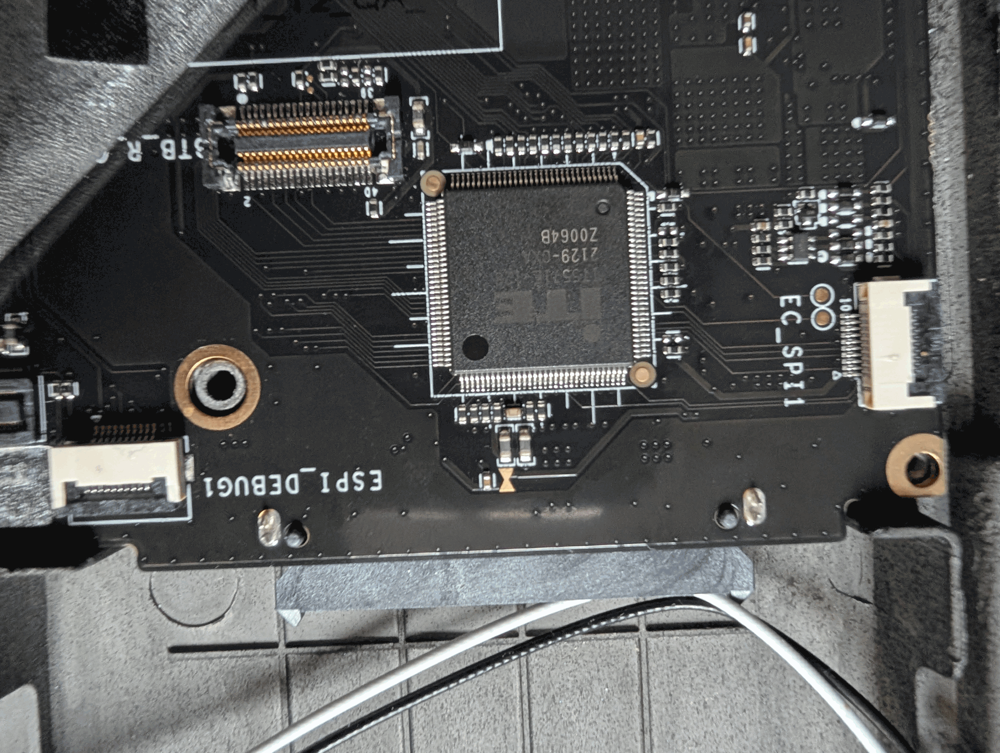
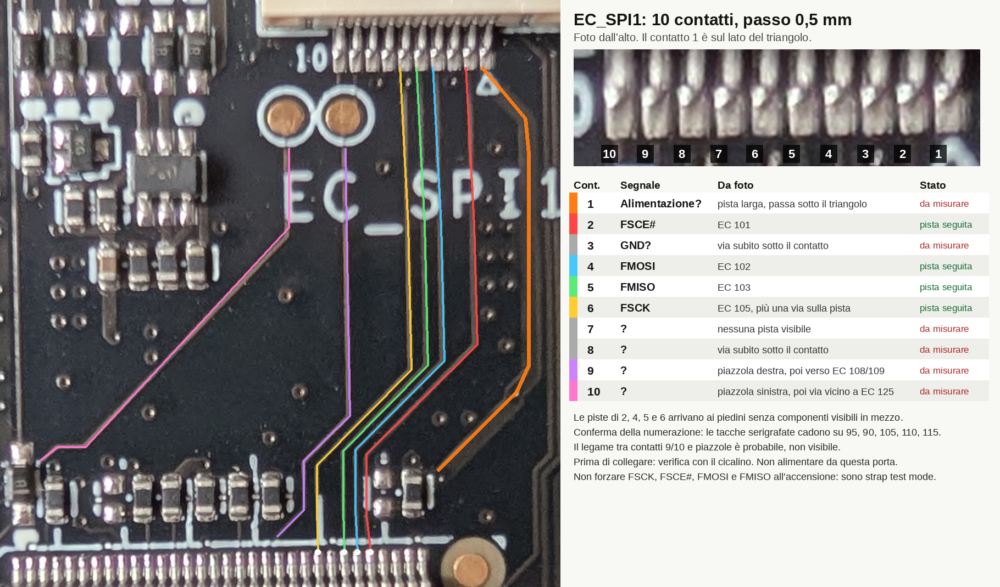
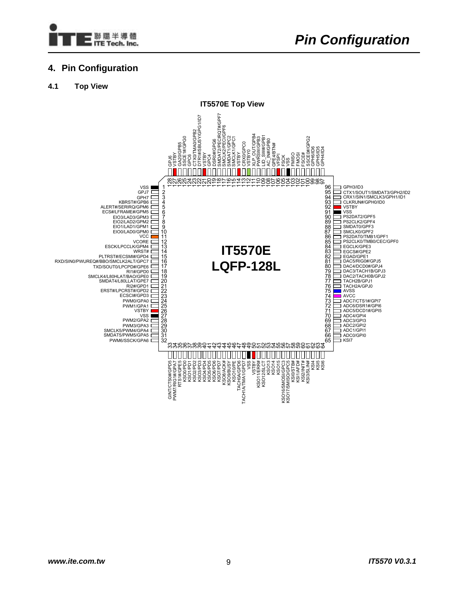

# X210AI — ITE IT5571 EC: guida completa

Reverse engineering del firmware EC della scheda **X210AI**, patch della tastiera, lettura, scrittura e recovery di EC e BIOS.

Il chip è un **ITE IT5571 rev. 2**: core **8051**, eFlash embedded da 128 KiB, package **LQFP-128** con piedini (14×14 mm, passo 0,4 mm). È quindi la variante `IT5571E-128`, non la VFBGA. Il package è visto in foto (§13): il marking completo va letto sul chip.

**Per flashare parti da [`firmware/README.md`](firmware/README.md):** contiene tutte le versioni, le istruzioni e la conferma. Questa guida raccoglie analisi, rischi e recovery.

| Percorso | Contenuto |
|---|---|
| [`firmware/`](firmware/README.md) | Originali, immagini patchate, versioni da non usare, hash |
| `tools/` | `patch_keyboard.py`, disassembler `i8051.py`, emulatore `emulator/` |
| `usb-tools/` | `ifu.efi`, `Fpt.efi`, UEFI Shell |
| `bios-dumps/` | Due letture del BIOS, non analizzate |
| `refs/` | Immagini, foto e note sul datasheet |
| [`TODO.md`](TODO.md) | Cosa resta da fare |

I pacchetti originali stavano in `inputs/`, che non è nella repo né in questa cartella: i percorsi `inputs/` di §1 restano come riferimento agli hash.

## Stato del progetto

| Area | Stato |
|---|---|
| Firmware EC | **Sulla scheda c'è `EC-V0.4.0-all-keys.bin`**, tasti confermati su tastiere ISO e JIS, rilascio di Fn confermato ([storico](firmware/README.md#storico-dei-flash)), hash del dump non registrato. Confronto in §9, patch `V0.4.0` con CRC corretto in §5 |
| Lettura EC | **Riuscita con `ifu.efi /S 128 /k /j`**: due letture identiche (§6). Le altre vie non sono provate (§6, §7) |
| Scrittura EC | **`ifu` ha flashato `EC0416`, `iso-jis`, `iso-jis-fn-ctrl-swap` e `all-keys` con successo**: immagini con CRC ricalcolato e codice aggiunto partono sulla scheda (§9). Con RP2040 è possibile, ma con punti aperti (§7) |
| Immagine BIOS | Due letture identiche da 32 MiB nella repo, non analizzate (§1, §8, §10) |
| Brick segnalati | Meccanismo più probabile trovato nel codice di `ifu`, non riprodotto (§9) |
| Recovery | Descritta, mai provata su questa scheda (§11) |
| Porta EC_SPI1 | Pinout parziale da foto: 4 contatti su 10 sono FSPI. Accesso all'eFlash non documentato, test mode da chiarire (§13, §14) |

**Eseguito sulla X210AI:** `ifu.efi` in lettura (§6) e quattro flash, l'ultimo con `all-keys` (§9). `Fpt.efi` è stato solo disassemblato.

**Prossimi passi:**

1. Registrare l'hash del dump di `all-keys` e provare le altre combinazioni con Fn ([conferma](firmware/README.md#conferma)).
2. Decidere se tenere i dump BIOS nella repo (§1).
3. Cicalino sui 15 piedini verso il connettore tastiera, iniziando da KSO1 sui contatti 16 e 18 (§7).
4. Accesso al connettore tastiera: cavo di una tastiera X201 guasta o spina JAE AA01 a 40 posizioni, codice non ancora trovato (§7).
5. Cablaggio RP2040, poi `isp id` e `isp read` con l'EC sano: il risultato va confrontato con il firmware installato in quel momento (§1). Niente scritture prima (§7).
6. Cicalino sui contatti 1, 3, 7, 8, 9 e 10 di `EC_SPI1`: massa, EC 119, EC 100 e piedini SMBus (§13).

## Indice

**Firmware EC**

- [Versioni, flash e conferma](firmware/README.md)
- §1 [File e hash](#1-file-e-hash)
- §2 [Architettura e mappa memoria](#2-architettura-e-mappa-memoria)
- §3 [Firme e checksum](#3-firme-e-checksum)
- §4 [Tastiera, ISO e JIS](#4-tastiera-iso-e-jis)
- §5 [Patch della tastiera](#5-patch-della-tastiera)

**Lettura**

- §6 [Lettura dell'EC](#6-lettura-dellec)
- §7 [Guida RP2040: ISP dal connettore tastiera](#7-guida-rp2040-isp-dal-connettore-tastiera)
- §8 [Lettura del BIOS](#8-lettura-del-bios)

**Scrittura e recovery**

- §9 [Scrittura dell'EC con ifu: rischi](#9-scrittura-dellec-con-ifu-rischi)
- §10 [Scrittura del BIOS con Fpt](#10-scrittura-del-bios-con-fpt)
- §11 [Brick e recovery](#11-brick-e-recovery)
- §12 [Chip di ricambio](#12-chip-di-ricambio)

**Interfaccia EC_SPI1**

- §13 [Porta di debug EC_SPI1](#13-porta-di-debug-ec_spi1)
- §14 [Guida: riconoscere il pinout](#14-guida-riconoscere-il-pinout)

**Varie**

- §15 [Strumenti e convenzioni](#15-strumenti-e-convenzioni)

---

## 1. File e hash

| File | SHA256 | Note |
|---|---|---|
| `firmware/original/EC-V0.4.0-20250723-lettura1.bin`, `-lettura2.bin` | `9b8334bd5d5986ce97dfc5d8503fa643a97d8abb6c6166ce181c0525ec722311` | **Firmware originale della scheda**, letto il 2026-11-04. 131072 B, build `V0.4.0` 2025-07-23 18:11:04. Due letture identiche. Base delle patch e file di ritorno |
| `firmware/patched/EC-V0.4.0-all-keys.bin` | `d96e1b3e6a4f0fd1a3ea288b234afae3ad41dcb460b40419300df3ea40005894` | ISO, JIS, scambio Fn↔LCtrl, Back, Forward, ThinkVantage, pull-up e rilascio di Fn (98 byte + CRC). **Installata sulla scheda**, tasti ISO e JIS e rilascio di Fn confermati |
| `firmware/patched/EC-V0.4.0-iso-jis.bin` | `7ee70df0894832da7ed47dab8e2fda7674ea505c643ffb4b75d113f491471a74` | `V0.4.0` con tasti ISO e JIS (7 byte + CRC). ISO confermata, JIS confermata su `all-keys` con le stesse celle. File di ritorno |
| `firmware/patched/EC-V0.4.0-fn-ctrl-swap.bin` | `e1f1386daef06d7b51c5d65d8c1fc4764be7b33173d82a192db95b68f15be07f` | `V0.4.0` con scambio Fn↔LCtrl (3 byte + CRC), mai provata |
| `firmware/patched/EC-V0.4.0-iso-jis-fn-ctrl-swap.bin` | `a3f1ff4e1bdd374692f2854a7a8be4a48375938c5959f3e4643539e88675d57f` | ISO/JIS e scambio (10 byte + CRC). ISO e scambio confermati, JIS confermata su `all-keys` con le stesse celle. File di ritorno |
| `firmware/original/EC0416.BIN` | `acaf8fed4b797f39d983849b916baaf61352832b337950fa9fb3225994cb6dca` | Installata il 2026-11-05 e poi sostituita, più vecchia della `V0.4.0` originale. 131072 B, build `V0.3.2` 2025-04-15 18:20:35, md5 `7392fa5138c906ac17c7049fa69514e7` |
| `firmware/obsolete/EC0416_ctrl-caps-swap.BIN` | `21f63a733dd5ee8b338ffefcda093ffec8d38c38138bc97c1e82a65a20acd406` | Patch demo L-Ctrl↔CapsLock (2 byte). **CRC non aggiornato, non flashare** |
| `firmware/obsolete/EC0416_fn-ctrl-swap.BIN` | `970431688f10aa160973d3f276c453e5cc86427a28a01ee34ef43ea17dfabee8` | **Errata, non usare:** cambia Alt+SysRq, non Fn, e ha il CRC vecchio (§3, §5) |
| `inputs/ec/MTLH-NB06-ec-250322/MTLH-NB06_E03-250322.BIN` | `151edd7a59cad1eb4a3d7b0827ee0937f73f0645a3cbf8d532f5e6bc0de5bbde` | EC vecchia, build 2025-03-22, md5 `4bbc1e54aad8cac51a3e0a5e5274ed28` |
| `inputs/ec/X210AI-EC-updated-on-03-22.zip` | `b850c8941df6eecbea035aefe481eb1c50fe8d5da4ea9b333717fc7a7230bc4e` | Archivio originale di `MTLH-NB06-ec-250322/` |
| `inputs/bios/X210AI0724BIOS.rar` | `a1090b7986e6e3cb2485333f73fd5f8d62822f64bedfe7cad5733e88ddd94663` | Solo strumenti, estratti in `inputs/bios/extracted/`. **Nessuna immagine BIOS** |
| `inputs/datasheets/IT5571E-128.pdf` | `a4e4afae8a157b7424401cf65c9dbecddce937b8b88a3dc1474124439bfc5753` | Datasheet sintetico, 29 pagine |
| `inputs/datasheets/IT5570_A_V0.3.1_U.pdf` | `01666ebe44ece4a436b5ffaad40c9570c17f0b3480862caf224953585c59102f` | IT5570 V0.3.1, parente stretto dell'IT5571 |

Sezioni del datasheet usate: `refs/DATASHEETS.md`.

**Immagine BIOS.** `fb.nsh` chiama `MTLH-NB06_B0.2.bin`, che non è incluso nel pacchetto. In locale ci sono `bios-dumps/full.bin` e `full2.bin`: 32 MiB, identici (SHA256 `dd6e311622b8c61fe8c51de8fef8f3ff28b625dffc5097836f12f5cd5b884669`), con flash descriptor a `0x10` e volumi `_FVH`. Sono nella repo dal commit `21485db` e non sono stati analizzati.

| File del pacchetto | Ruolo | Note |
|---|---|---|
| `inputs/bios/extracted/uefi-shell/EFI/BOOT/BOOTX64.efi`, `BOOTIA32.efi` | UEFI Shell, build 2013 | Non scrive nulla: è l'ambiente da cui lanciare i tool, da copiare in radice sulla chiavetta |
| `inputs/ec/MTLH-NB06-ec-250322/ifu.efi` | ITE Flash Utility 2.3.1a, build DEBUG | Legge e scrive l'EC. Presente solo nel pacchetto EC |
| `inputs/bios/extracted/Fpt.efi` + `fb.nsh` | Intel Flash Programming Tool | Legge e scrive il chip SPI del BIOS |
| `inputs/bios/extracted/fparts.txt` | Lista di 204 flash SPI | Le voci non sono validate, lo dice il file stesso |
| Tutorial `.docx` nel pacchetto BIOS | Guida generica con esempi di un altro modello (R51) | Non tratta backup, alimentazione, errori o recovery |

## 2. Architettura e mappa memoria

- CPU **8051**; vettore reset `0x0000` → `LJMP 0x0070` (init: SP=0xC0, FPCFG `0x1001=0x3F`, copia tabelle XRAM, main `0x0400`). Vettori standard `0x03/0x0B/0x13/0x1B/0x23/0x2B`; interrupt estesi ITE: stub `LJMP 0x28xx` → dispatcher `0x2800`; trampoline `0x2B6B-0x2BE0` (`MOV DPTR,#handler; AJMP 0x2800`).
- **4 banchi × 32 KiB**, finestra commutabile `0x8000-0xFFFF` (Bank base xdata `0x1300h`; FLHCTRL2R `0x1032` scritto a `0x251E`). Banco0 `0x0000-0x54D4` (fisso) + firma testuale `0x7F80`; banco1 `0x8000-0xF8A4`; banco2 `0x10000-0x15515`; banco3 `0x18000-0x18132` (stub bank-switch); resto `0xFF`.
- Base registri (datasheet, sezione 3.2): SMFI `0x1000h` (FLHCTRL1R `0x1031`, ECINDAR `0x103B-0x103F`, protect P0BA `0x104F+`), INTC `0x1100h`, EC2I `0x1200h`, **Bank `0x1300h`**, Common `0x1400h`, PMC `0x1500h`, GPIO `0x1600h`, PS/2 `0x1700h`, WUC `0x1B00h`, KBS `0x1D00h`, BRAM `0x2200h`.
- KBC host = xdata `0x004B/0x004C` (porte `0x64/0x60`); PD/UCSI in banco0 `0x3400-0x4300` (USB-C PD, controller esterno Analogix).

## 3. Firme e checksum

- **Nessuna firma crittografica trovata**: niente costanti SHA/RSA/MD5, blocco `0x7F80` solo testo e non referenziato, reset `0x0070` non verifica la flash, e il firmware non legge da codice la zona `0x40-0x4F`.
- **16B-signature a `0x40`** (`A5…A4 95 85 12 26 E6 AA 00 55 55`): marcatore di power-on per localizzare la code base (datasheet, sezione 6.4.3.11.1, formato "implicit" → base `0x000000`). **Va preservata nelle patch** (offset validi `0x40-0xF0`).
- **CRC a `0x4A-0x4B`:** è un **CRC-16/CMS** big endian (polinomio `0x8005`, init `0xFFFF`, senza riflessione, senza XOR finale) su tutti i 128 KiB esclusi i 16 byte della firma `0x40-0x4F`. Trovato provando tutti i 65536 polinomi su 12 intervalli: è l'unico risultato e torna esattamente sulle tre build ufficiali (`F9 0C` del 22 marzo, `26 E6` di `EC0416`, `AF 5B` della `V0.4.0`). Va **ricalcolato dopo ogni modifica**: `tools/patch_keyboard.py` lo fa, e `--check` verifica un'immagine.
- **Chi controlla il CRC:** non è noto. Il firmware non lo legge, quindi può essere la boot ROM o nessuno. Datasheet e System76 hanno `5A 5A` fissi, e System76 avvia su IT5570: forse è un valore che salta il controllo, ma non è verificato. Un CRC corretto è comunque la scelta prudente.
- Protezione in scrittura: il firmware non scrive i registri P0BA-P3ZR.

## 4. Tastiera, ISO e JIS

- **KBS matrix 18×8** (base `0x1D00h`: KSOL/KSOH1/KSOCTRL/KSOH2/KSI@`0x1D04`/KSOxLSDR `0x1D10-0x1D21`). Driver in banco1 `0x9300-0x9F00`: loop 16 righe KSO, legge KSI, indice `0x4D=(col<<4)|row|0x08`.
- **Tabella matrice `0x2EB9`:** 128 byte, indice `(KSI<<4)|KSO` (`0x8CB2`). Identica in `EC0416` e `V0.4.0`. La tabella `0x2F39` (24 byte, 2 KSO extra) è vuota. Le voci sono codici interni, non scancode (vedi sotto).
- **Codici interni** (`0x8D77`): `<0x80` set 2 diretto; `0x80-0x9B` tabella `0x3060` (`0x82` LWin, `0x84` Menu, `0x88` LShift, `0x89` RShift, `0x8A` LAlt, `0x8B` RAlt, `0x8C` LCtrl, `0x8D` RCtrl, `0x8E` Fn); `0x9C-0xDF` varianti a `0x2FE3`; `≥0xE0` coppie normale/Fn a `0x3046`.
- **Fn:** non è in matrice. È il pin `0x1608` bit 7 (attivo basso, `0xC447`), con debounce nella voce 4 della tabella `0x2795`. Pressione e rilascio chiamano `0x8D77` con `0x8E` (`0xC45E`, `0xC465`), che imposta il bit `0x40` dello stato tastiera in iRAM `0xBC`. Quel pin non viene letto altrove. È GPH7 (piedino 3): `GPCRH7` `0x164F` vale `0x80`, cioè ingresso **senza pull-up interno**. La linea va solo a massa, quindi senza una resistenza sulla scheda resta flottante. Il debounce vale 6 letture uguali.
- **Conversione scancode**: routine `0x0C09` (F0→break marker 0xFF, bit E7→casi speciali `0x83→0x41`/`0x84→0x54`, break `\|0x80`) e tabella **set2→set1 `0x0D03`** (128 B). Qui `0x83` e `0x84` sono byte set 2 già in uscita: F7 e Alt+SysRq. Sequenze multi-byte (Pausa `E1 14 77`): `0x25B2`; comandi PS/2: `0x2636`.
- KBC 8042 (IRQ1/IRQ12, A20G): init `0x0A76`, dispatcher eventi `0x0D9C` (flag bit `0x30-0x3D`).
- Flusso: KBS scan → tabella matrice → scancode set2 → conversione set1 → buffer KBC → porta `0x60` + IRQ1.
- **ISO/JIS:** la tabella `0x0D03` copre tutti i set-2 necessari, ma **la matrice no**: le celle dei tasti ISO e JIS sono a `0x00`, e `0x8D77` scarta quel codice. Da qui il sintomo di `ù` e `<>` che non arrivano all'OS, in tutte le build viste.
- **Confronto con ThinkPad:** la matrice coincide, trasposta, con la X220 di [thinkpad-ec](https://github.com/hamishcoleman/thinkpad-ec/blob/master/docs/table_matrix.txt): 88 celle occupate in comune e 52 tasti di scrittura su 52 con il codice atteso. Lì i codici sono numeri di tasto IBM, quindi quelli "sconosciuti" sono 14 Yen, 131 Muhenkan, 132 Henkan e 133 Kana. Differenze: LWin sta in `KSI2/KSO11` invece di `KSI3/KSO9`, e il firmware originale non ha ThinkVantage, Mic e PgBk/PgFd. La patch `all-keys` aggiunge tutti questi tasti tranne Mic (§5).
- **Confronto con X20x JIS:** l'adattatore [bulat-chu](https://github.com/bulat-chu/Thinkpad-X6x-X20x-keyboard-USB-Adapter) documenta la matrice reale di una tastiera X6x/X20x giapponese. Convertita con il suo `pinout.txt` e con `matrix_pins`, dà 49 tasti su 49 uguali al firmware e conferma Yen, Ro, Muhenkan, Henkan, Kana e la cella `KSI6/KSO7`, che lì è `]` e su ISO è `#`. Anche LWin in `KSI2/KSO11` coincide con il suo `table-main.txt`, che ha però L_Shift e R_Shift scambiati rispetto al suo `keymap.c`. La cella ISO `<>` (`KSI5/KSO1`) non esiste su una tastiera JIS: viene solo dalla X220, ma è libera.
- **Rilascio di Fn:** la routine `0x8CFA` riceve l'evento, lo salva in `0x080E` e non lo usa: sceglie la variante Fn guardando Fn al momento del rilascio. Rilasciare Fn prima del tasto, o premerlo dopo, manda il rilascio di un altro tasto: Fn+F2 emette `E0 1F 4B` (Win+L) e poi `F0 06`, lasciando Win e L premuti. Vale per 18 tasti ed è nel firmware originale. La mappa XRAM `0x00E0-0x00EF` letta da `0x8CFA` viene solo azzerata.
- **Tasti rilevati e scartati:** la scansione legge qualsiasi incrocio KSO/KSI, ma un codice `0x00` si ferma in `0x8E41` (`JZ` a `0x8E51`) e non arriva al KBC. Valeva anche per ThinkVantage (`KSI5/KSO10`) e Back/Forward (`KSI6/KSO11`, `KSI7/KSO11`). Dedotto dal codice e confermato con `evtest`: gli stessi tasti arrivano a Linux una volta scritte le celle (§9).

## 5. Patch della tastiera

**Patch `V0.4.0`.** `tools/patch_keyboard.py` parte dal dump `V0.4.0`, ne controlla l'hash e i byte attesi, ricalcola il CRC (§3) e genera i quattro file `firmware/patched/EC-V0.4.0-*.bin` (§1). Ogni file è verificato per dimensione, vettore di reset, firma e CRC: questi controlli non dicono nulla sulla correttezza del codice. Sono state flashate `iso-jis`, `iso-jis-fn-ctrl-swap` e `all-keys`, che funzionano. Solo `fn-ctrl-swap` non è provata sull'hardware.

| Byte | Da → a | Effetto |
|---|---|---|
| `0x2F0A` (`KSI5/KSO1`) | `00 → 61` | ISO `<>` |
| `0x2F20` (`KSI6/KSO7`) | `00 → 5D` | ISO `#`, `ù` su layout italiano |
| `0x2EE1` (`KSI2/KSO8`) | `00 → 6A` | JIS Yen |
| `0x2F2E` (`KSI7/KSO5`) | `00 → 51` | JIS Ro |
| `0x2F29` (`KSI7/KSO0`) | `00 → 67` | JIS Muhenkan |
| `0x2F0F` (`KSI5/KSO6`) | `00 → 64` | JIS Henkan |
| `0x2F2F` (`KSI7/KSO6`) | `00 → 13` | JIS Katakana/Hiragana |
| `0x2EC8` (`KSI0/KSO15`) | `8C → 8E` | Il tasto LCtrl fa da Fn |
| `0xC461`, `0xC468` | `8E → 8C` | Il tasto Fn fa da LCtrl |
| `0x2F24` (`KSI6/KSO11`) | `00 → 87` | Back, solo in `all-keys` |
| `0x2F34` (`KSI7/KSO11`) | `00 → 8F` | Forward, solo in `all-keys` |
| `0x306E` | `5E → 38` | Codice `0x87`: da `E0 5E` a `E0 38`, Linux `KEY_BACK` |
| `0x307E-0x307F` | `20 05 → 30 01` | Codice `0x8F`: da modificatore inutilizzato a `E0 30`, Linux `KEY_FORWARD` |
| `0x2F13` (`KSI5/KSO10`) | `00 → 08` | ThinkVantage come F13 set 2, Linux `KEY_F13` |
| `0x2764` | `80 → 84` | `GPCRH7`: pull-up interno da 75 kΩ sul pin di Fn, solo in `all-keys` |
| `0x8CFA-0x8CFC` | `90 08 0E → 02 56 00` | Salto alla nuova routine di Fn, solo in `all-keys` |
| `0x5600-0x564D` | `FF → codice` | Salva Fn alla pressione nella mappa `0x00E0` e lo riusa al rilascio, solo in `all-keys` |
| `0x4A-0x4B` | `AF 5B → 79 1C` | CRC di `all-keys`. Negli altri file vale `F1 49` (ISO/JIS + scambio), `44 C4` (ISO/JIS), `1A D6` (scambio) |

I codici interni `0x87` e `0x8F` non sono usati da matrice, overlay o codice. Mappatura Linux verificata su `drivers/input/keyboard/atkbd.c`, compresi i tasti JIS: Yen 124, Ro 89, Muhenkan 94, Henkan 92, Katakana/Hiragana 93. Con `evtest` sulla scheda arrivano Back, Forward, F13 e tutti i tasti JIS.

**Verifica con emulatore 8051.** Esegue il codice reale del firmware con le periferiche simulate. Risultati su `all-keys`:

| Prova | Risultato |
|---|---|
| 127 celle, pressione e rilascio, da sole e con Shift, Fn o Ctrl tenuti | 508 casi, cambiano solo i tasti previsti |
| I 10 tasti nuovi, byte per byte | 40 casi su 40 |
| Fn rilasciato prima del tasto o premuto dopo | Originale 18 tasti errati su 127, patch 0 |
| Sequenze casuali da 600 eventi | Tasti bloccati: patch 0 su 100, originale 300 su 300 nella prova iniziale |
| Boot differenziale, 3 milioni di istruzioni | Unica scrittura diversa: `0x164F=84` |
| Errori inseriti apposta | Tutti rilevati, 15 su 15 |

Nelle sequenze casuali non contano Pausa, che contiene già il suo rilascio, e i falsi shift `E0 12` ed `E0 59`, ignorati da Linux. L'emulazione parte dopo il debounce per i tasti di matrice, simula i registri e non può provare la boot ROM né il cablaggio. Per rilanciare tutto: `python3 tools/emulator/run_tests.py`, circa un minuto. Le altre tre immagini passano la stessa suite e mantengono il bug del rilascio, come atteso.

Il pull-up segue il T61 di [USB_Laptop_Keyboard_Controller](https://github.com/thedalles77/USB_Laptop_Keyboard_Controller/tree/master/Example_Keyboards/Lenovo_ThinkPad_T61/Teensy%204p0) (`go_pu(HOTKEY)`) e l'adattatore X20x (il suo commento dice "active HIGH", ma il codice legge attivo basso con pull-up). Se la scheda ha già una resistenza, il datasheet consiglia di lasciarlo spento: i due pull-up in parallelo aumentano solo la corrente.

Le celle ISO/JIS erano vuote: se su una tastiera non c'è il tasto, non cambia nulla. Le posizioni JIS sono confermate sulla scheda con una tastiera giapponese, `<>` con una ISO (§9). RCtrl non cambia.

**Patch `EC0416` (basate sulla `V0.3.2`):** restano solo come storia, non vanno flashate (vedi sotto).

**Regole:** dimensione fissa 128 KiB (pad `0xFF`), 16B-signature intatta tranne il CRC `0x4A-0x4B`, che sta al suo interno e va ricalcolato (§3), tabelle non spostate (indirizzi assoluti). Una patch non deve toccare il gestore `0xDC` né il ciclo di flash, da cui dipende `ifu`. Prima di flashare leggere §9.

- **Tasti visibili all'host:** tabella `0x0D03`. Demo `firmware/obsolete/EC0416_ctrl-caps-swap.BIN`: swap L-Ctrl `0x14`↔Caps `0x58`, byte `0x0D17`↔`0x0D5B`.
- **Le patch `EC0416_*.BIN` hanno il CRC vecchio:** non flasharle.
- **`firmware/obsolete/EC0416_fn-ctrl-swap.BIN` è errata, non usarla.** Cambia il caso `0x84` in `0x0C09` (`0x54→0x1D`), che è il byte set 2 di Alt+SysRq. Fn è fuori matrice (§4), quindi la patch non lo tocca: trasforma Alt+SysRq in LCtrl. La verifica qui sotto conferma solo quel byte, non il suo significato.
- **Fn e BIOS:** non c'è logica di swap né flag BIOS (BRAM `0x2200h` non usata come setting).

Verifica di `EC0416.BIN` contro `EC0416_fn-ctrl-swap.BIN`:

| Check | Esito |
|---|---|
| Dimensione | 131072 B in entrambi |
| Byte modificati | **1 solo**: `0x0C35`: `0x54 → 0x1D` |
| Hash patch | md5 `26ea0534446468c3e863e9f372d2de0a`, sha256 `97043168…fabee8` |
| 16B-signature, vettori `0x0000-0x003F`, tabella `0x0D03`, firma `0x7F80`, banchi 1-3 | Identici |
| Flusso istruzioni | Cambia solo l'operando di `MOV R7,#imm` a `0x0C34`, lunghezza invariata |

```
0C30: EF        MOV A, R7
0C31: B4 84 04  CJNE A, #0x84, 0x0C38
0C34: 7F 1D     MOV R7, #0x1D     ; patchato (originale: 7F 54)
0C36: 7E 01     MOV R6, #0x01
```

Emulazione di `0x0C09`: `0x84` → `0x1D`/`0x9D` make/break, stesso output di L-Ctrl (`0x14`); gli altri tasti provati (0x83, 0x14, 0x58, 0x76, 0x5A, 0x29, 0x61) restano invariati.

Riferimento della matrice: [thinkpad-ec, `docs/table_matrix.txt`](https://github.com/hamishcoleman/thinkpad-ec/blob/master/docs/table_matrix.txt).

## 6. Lettura dell'EC

L'eFlash è dentro il chip, quindi una clip SOIC o un programmatore SPI non la raggiungono: i pin FSPI servono solo per una flash esterna (datasheet Table 5-5). `flashrom -p internal` e `Fpt` leggono il BIOS, non l'EC.

La via software è stata provata sulla scheda il 2026-11-04. Le altre no. Partire sempre dalla sola lettura.

| Via | Strumento | Serve EC funzionante? | Stato |
|---|---|---|---|
| **Software** | `ifu.efi /S 128 /k /j` | Sì | **Provata**: due letture identiche. Vedi sotto |
| **EPP dal connettore tastiera** | RP2040 + [ITE-EC-Pico-USB-Parallel-ISP](https://github.com/bernTP/ITE-EC-Pico-USB-Parallel-ISP) | No | **Via consigliata per la recovery.** Provato solo su IT5261 (§7) |
| **EPP dal connettore tastiera** | Arduino Mega 2560 + [system76/ec](https://github.com/system76/ec/blob/master/docs/flashing.md) | No | Documentato per IT5570. Mappa pin da adattare |
| **EPP con porta parallela reale** | Cavo DB25 (datasheet, sezione 7.24.3.1) + tool ITE | No | Cavo documentato, tool ITE non disponibile |
| **DBGR/SMB** | FT232H + [`iteflash`](https://chromium.googlesource.com/chromiumos/platform/ec/+/6555d8eefedd62af8f0b0e890cb3e696690a76cc/docs/ite-ec-reflashing.md) | No | Serve accesso alle linee SMBus. Tool da modificare, vedi sotto |
| **Fuori scheda** | Dissaldatura + zoccolo LQFP-128 + programmatore con algoritmo ITE ("ITE Download Board 4") | No | Ultima risorsa. Il T48 non serve: `T48_List.txt` V13.16 ha 0 IC ITE |

Il debug I2EC sulle porte `2Eh/2Fh` accede alla memoria dell'EC dal lato host: non è una via documentata per il dump della eFlash.

La procedura di alimentazione cambia con lo strumento: il progetto Pico tiene l'alimentatore collegato senza batteria, la guida System76 vuole la macchina senza alimentazione. Seguire quella dello strumento, confrontandola con il requisito VSTBY del datasheet.

### Lettura con ifu

`ifu.efi` ha un'opzione **non documentata** nell'help, trovata nel codice (`0x4DCA`, `0x5174`):

```
ifu.efi /S 128 /k /j
```

Maiuscole e minuscole contano. Salva 128 KiB in `ITEFW.bin` nella cartella corrente. La routine `0x422C` usa solo la lettura veloce `0x0B`, senza cancellazioni né scritture, quindi **non può causare il brick descritto in §9**.

**`/k /j` sono obbligatori.** Con il solo `/S 128` si ottiene un file da 0 byte, anche su volumi diversi (provato su chiavetta e partizione EFI). `ifu` crea il file (`0x519B`), legge (`0x526F`), invia `0xFE` (`0x5294`) e solo alla fine chiude il file (`0x5AFE` → `0x9F4C`): se il reset spegne la macchina, i dati non arrivano mai al disco.

- `/j` invia `0xFC` invece di `0xFE`: l'EC salta a `0x0400` senza reset (`0x80C4`).
- `/k` salta l'`0xAE` finale (`0x52A9`), inutile perché `/S` non invia `0xAD`, e la sua attesa senza timeout.
- Con il solo `/S 128` è stato osservato uno spegnimento brusco. Con `/k /j` il comportamento a fine dump non è stato annotato: l'EC riparte senza un vero reset, quindi spegnere subito con `reset -s`.
- Usa lo stesso ingresso `0xDC`: l'EC si ferma durante la lettura.
- Se il tool si blocca non c'è timeout: serve togliere l'alimentazione, compresa la batteria.
- Con un byte residuo sulla porta `0x62` (§9) il dump esce spostato di una posizione. Controllare dimensione e firma.
- Non funziona su un EC brickato.
- La partizione EFI è leggibile solo da root: da Linux copiare il dump con `sudo install -o $USER -g $USER -m 644`.

### Lettura con DBGR/SMB

`iteflash` è scritto per IT83xx su FT4232 (Servo v2): `check_chipid()` accetta solo `0x83xx` e usa l'interfaccia B, quindi per IT5571 e FT232H va modificato. Protocollo: waveform 50 ms su clock e dati, poi I2C 400 kHz agli indirizzi `0x5A/0x35/0x79`. FT232H: solo 3,3 V, pull-up esterni, DO e DI uniti per SDA. DBGR/SMB si attiva a caldo, ma si esce solo con un reset (datasheet, sezione 7.23.3.2): prevedere un ciclo di alimentazione.

### Verifica del dump

Ogni dump va controllato così, qualunque sia lo strumento:

1. Dimensione 131072 byte.
2. 16B-signature a `0x40` (§3).
3. Due letture identiche.
4. Confronto con il file flashato per ultimo (§1): oggi `EC0416.BIN`, dopo il prossimo flash `EC-V0.4.0-all-keys.bin`.

## 7. Guida RP2040: ISP dal connettore tastiera

**Non provata sull'IT5571.** Il progetto è testato su IT5261 (ThinkPad T14s), dove ha letto e aggiornato il firmware. I segnali coincidono con il datasheet IT5570 (sezione 7.24.3.1, Table 5-19, Table 5-21), ma la numerazione del connettore della T14s non vale qui: i collegamenti vanno ricavati sulla scheda.

| Operazione | Giudizio | Motivo |
|---|---|---|
| **Lettura** | **Probabile** | Il datasheet prevede ISP via EPP, il firmware non disabilita DBGR/EPP (§13) e il tool gestisce gli ID `0x5xxx`. Con `-s 128` si forza la dimensione |
| **Scrittura** | **Possibile, non ancora sicura** | Il tool sa scrivere, ma restano i punti aperti sotto |

L'ingresso avviene all'accensione con lo strap `KSI[5,4,2,1]=0011b`, con VSTBY presente e l'EC saldato sulla scheda. Non dipende dal firmware: in linea di principio funziona anche con EC brickato.

### Collegamenti

Una resistenza da **1 kΩ in serie su ogni linea** (470 Ω-1 kΩ), 15 in totale.

| Pico GPIO | Pin Pico | Segnale EC | Pin EC (LQFP-128) | Funzione |
|---|---|---|---|---|
| GP0-GP3 | 1, 2, 4, 5 | KSO0-KSO3 | 36-39 | PD0-PD3 |
| GP4-GP7 | 6, 7, 9, 10 | KSO4-KSO7 | 40-43 | PD4-PD7 |
| GP8 | 11 | KSI0 | 58 | STB# |
| GP9 | 12 | KSI1 | 59 | AFD# |
| GP10 | 14 | KSI2 | 60 | INIT# |
| GP11 | 15 | KSI3 | 61 | SLIN# |
| GP12 | 16 | KSI4 | 62 | Strap, tenuto basso |
| GP13 | 17 | KSI5 | 63 | Strap, tenuto basso |
| GP14 | 19 | KSO9 | 45 | BUSY |
| GND | 3, 8, 13, 18 | Massa della scheda | Non dal connettore | Vite o schermo USB |

La mappa dei GPIO sta in `firmware/hwconfig.h` del progetto RP2040: PD0-PD7 devono restare su 8 GPIO consecutivi.

**Mai collegare `3V3` o `VBUS` del Pico alla scheda:** in comune c'è solo la massa.

### Connettore tastiera



Il connettore è il **11** dello [schema del produttore](refs/img/scheda-porte-debug.png): un board-to-board per tastiera **ThinkPad X201**, 40 contatti su 2 file da 20, passo 0,5 mm. Serigrafia letta da foto: `BTB_R…`. Non è un FPC, quindi una breakout FFC non entra.

Il riferimento è lo [schema dell'adattatore X201](https://github.com/bulat-chu/Thinkpad-X6x-X20x-keyboard-USB-Adapter), che usa il connettore JAE `AA01B-S040VA1`. Nel suo simbolo 41-44 sono a massa: i segnali sono 40. **Descrive la tastiera, non la X210AI.**

- **Numerazione:** contatti pari sulla fila verso l'EC, con `2` a sinistra e `40` a destra (EC a destra del connettore). Il pallino indica il contatto 1 sull'altra fila.
- **Ipotesi di mappa:** `DRVn` della tastiera = `KSOn` dell'EC, `SENSEn` = `KSIn`.
- **Verifica da foto:** le piste di KSO0-KSO4 portano ai contatti 22, 16, 14, 10, 2. Lo schema dà 22, 18, 14, 10, 2. Quattro su cinque coincidono, il KSO1 differisce di un contatto. Per i KSI non c'è nessun riscontro.

| Segnale EC | Pin EC | Contatto | GPIO Pico |
|---|---|---|---|
| KSO0 | 36 | 22 | GP0 |
| KSO1 | 37 | 18 (foto: 16) | GP1 |
| KSO2 | 38 | 14 | GP2 |
| KSO3 | 39 | 10 | GP3 |
| KSO4 | 40 | 2 | GP4 |
| KSO5 | 41 | 4 | GP5 |
| KSO6 | 42 | 8 | GP6 |
| KSO7 | 43 | 12 | GP7 |
| KSI0 | 58 | 5 | GP8 |
| KSI1 | 59 | 13 | GP9 |
| KSI2 | 60 | 9 | GP10 |
| KSI3 | 61 | 7 | GP11 |
| KSI4 | 62 | 11 | GP12 |
| KSI5 | 63 | 3 | GP13 |
| KSO9 | 45 | 20 | GP14 |

**Ogni riga va confermata col cicalino prima di saldare.**

**Da non collegare:** nello schema il 38 è +5 V e il 35 è +3,3 V, il 36 è la massa del tasto Fn (`HOTKEY` sul contatto 1), 31 e 34 sono massa. 37, 39 e 40 sono il TrackPoint a 5 V. Sulla X210AI vanno misurati: l'adattatore fornisce queste alimentazioni da sé.

**Cablaggio di Fn.** Il tasto è un interruttore fuori matrice tra il contatto 1 (`HOTKEY`) e il contatto 36. La nota dello schema dice che sulle X200/X201 il 36 fa da massa per `HOTKEY`, e l'adattatore lo collega a massa con un ponticello: quindi la massa arriva dalla scheda, non dalla tastiera. Servono due collegamenti sulla X210AI:

| Tratto | Fonte | Stato |
|---|---|---|
| Contatto 1 → EC piedino 3 (GPH7) | Firmware e datasheet per il piedino, schema X201 per il contatto | **Confermato dal funzionamento:** col tasto scambiato Fn fisico fa da Ctrl. Il contatto preciso non è misurato |
| Contatto 36 → massa | Schema X201 | **Confermato dal funzionamento**, altrimenti il tasto non si chiuderebbe. Non misurato |
| Pull-up esterno | Il firmware lascia il pull-up interno spento e il tasto funziona | Molto probabile, non visto |

Nelle foto la tacca serigrafata marca il piedino 1, poi 5, 10, 15. I primi due componenti della fila vicino all'angolo (uno scuro, uno color ocra) sono separati dagli altri da due barre di serigrafia e potrebbero essere un filtro RC con pull-up: è solo un'ipotesi.

**Accesso ai contatti:** l'adattatore monta una presa come quella della scheda, quindi non si innesta qui. Serve la spina JAE AA01 a 40 posizioni, il cui codice non è stato trovato, oppure il cavo piatto di una tastiera X201 guasta.

### Trovare i contatti

1. Scheda spenta, senza batteria e senza tastiera.
2. Multimetro in continuità: un puntale sul piedino dell'EC, l'altro sui contatti del connettore tastiera.
3. Annotare il contatto di ognuno dei 15 segnali. L'orientamento può risultare specchiato.
4. Con la scheda alimentata, misurare un KSI a riposo: circa 3,3 V. **Con 5 V fermarsi.**

Non saldare sui piedini dell'EC (passo 0,4 mm). Le vie sono i candidati da valutare: filo smaltato sottile, ancorato alla scheda, se risultano scoperte. In alternativa serve il connettore corrispondente con una breakout su misura, o i terminali del connettore. Con la tastiera scollegata nessun altro pilota queste linee.

### Sola lettura

1. Con BOOTSEL premuto, copiare `firmware/prebuilt/ite_pp_isp_pico.uf2` del progetto RP2040 sul Pico.
2. Sul PC Linux eseguire `host/setup_venv.sh` e installare le regole udev.
3. Togliere la batteria e lasciare scollegato l'alimentatore. Non premere il tasto di accensione.
4. Eseguire i comandi, con `isp` come abbreviazione di `host/.venv/bin/python host/ite_pp_isp.py`:

```
isp hello
isp lines                 # prima senza alimentatore, poi con
isp enter --mode powerup  # collegare l'alimentatore quando lo chiede
isp id
isp read -o x210ai-ec.bin -s 128 --no-exit
isp safe
```

Verificare il dump (§6). Tra un tentativo e l'altro spegnere e scaricare l'EC: il tool ammette un solo arresto della CPU per ciclo di alimentazione.

### Punti aperti prima di scrivere

Verificati nel codice del tool (`host/itepp/`).

- **Dimensione flash:** è il punto più serio. Il tool la ricava da EC `0x1080`, che sul datasheet IT5570 è `FLHCTRL5R`, non un registro di dimensione documentato. In lettura `-s 128` la forza, ma **`write` non ha quell'opzione**: se il valore rilevato non è 128 KiB, il tool va modificato.
- **Flash ID:** `write` accetta solo `ff ff fe`. Non è verificato che l'IT5571 lo restituisca: `ifu` sulla scheda ha stampato `SPIDeviceID= FF FF FF FF`, che va confrontato con `isp id`. `ifu` ha un ramo per il vendor `0xFF` con cancellazione da 1 KiB (`0xD7`), compatibile con questa ipotesi. In lettura si può aggiungere `--ignore-flash-id`.
- **Programmazione:** il tool usa AAI word, `ifu` usa AAI byte (`0xAF`, `0x3644`). Il primo funziona su IT5261, ma non è provato qui.
- **Protect path:** prima di cancellare, il tool azzera EC `0x20A0-0x20BF`. Quei registri non sono nell'elenco del datasheet IT5570 e il firmware non li referenzia direttamente. Valutare `--keep-protect-path`.
- **Area dati:** `EC_DATA_AREA` ha una voce solo per 256 KiB, quindi a 128 KiB `write` tratta tutta la flash come codice. In `EC0416.BIN` e nella build vecchia gli ultimi 16 KiB sono vuoti, ma va controllato il dump reale.
- **Chip ID e firma:** nessun blocco atteso. `0x5571` entra nel ramo IT5xxxx e `52 61 02` è solo un riferimento stampato. La sequenza `0xA5` richiesta nei primi 4 KiB è presente a `0x40`.

**Non usare `write`** finché lettura, dimensione, ID e area dati non sono verificati su questo chip. Il primo test di scrittura dev'essere un singolo settore riscritto con il proprio contenuto, usando `-R`.

## 8. Lettura del BIOS

Il BIOS sta su un chip SPI esterno, quindi qui un programmatore funziona. Fare il dump **prima di qualsiasi flash**: le due letture in `bios-dumps/` (§1) vanno verificate prima di considerarle un'immagine di recovery.

**Dalla macchina funzionante:**

- UEFI Shell: `fpt.efi -d full.bin`
- Linux: `flashrom -p internal -r full.bin`

**Dal chip, a macchina spenta:** package SOIC-8, secondo `fparts.txt` W25Q128, MX25L12873, N25Q128 e simili a 3,3 V. Package e tensione sono dedotti da quella lista, non dalla scheda: leggere il marking e controllare il datasheet. Con una flash da 1,8 V serve un adattatore di livello.

| Programmatore | Note |
|---|---|
| **XGecu T48** | 3,3 V via software. App XGecu/MiniPro, oppure `flashrom -p xgecu-t48-spi` se supportato |
| **CH341A con mod 3,3 V** | Tagliare la pista o dissaldare il regolatore 5 V (78L05), alimentare VCC a 3,3 V. `flashrom -p ch341a_spi -r/-w/-v` |
| **CH341A senza mod** | Linee a 5 V: **pericoloso** su flash a 3,3 V. Solo con adattatore di livello |
| **RP2040** | `pico-serprog` + `flashrom`. Solo 3,3 V, non provato su questa scheda |

Procedura: dump due volte e confronto hash, verifica del chip (RDID), sblocco WP se protetta, scrittura e verifica, nuovo dump. Mai interrompere.

## 9. Scrittura dell'EC con ifu: rischi

Comando: `ifu.efi <file>.bin 128`, dalla UEFI Shell.

Ci sono segnalazioni di brick occasionali, non riprodotte qui. L'analisi non prova la causa di un caso specifico, ma indica un meccanismo probabile e mostra che `ifu` non ha margine d'errore.

### Come funziona

`ifu` richiede la collaborazione del **firmware in esecuzione**.

1. Invia `0xAD` al KBC e `0xDC` sulla porta `0x66`.
2. Il firmware disabilita gli interrupt, porta il ciclo di flash in Scratch ROM (`0xDC94`) e ci salta (`0x800C`; variante PMC2 `0xD9D3`, caso `0xDC` nella tabella `0xF61E`). Risponde `0x33` sulla porta `0x62`. Percorso PMC1: `0x0A0F` → `0x0A40` → `0x0928` → `0x8A62`, **senza condizioni**.
3. L'host pilota il follow mode. Per ogni blocco: cancella, verifica la cancellazione, programma, verifica.
4. Alla fine invia `0xFE`, reset tramite watchdog. Con `/j` invia `0xFC`, salto a `0x0400`.

Finché il ciclo gira, l'EC fa solo questo: ricarica, ventola e tastiera restano ferme nello stato corrente (deduzione dal codice).

### Meccanismo di brick più probabile

Ipotesi ricavata dal codice, non riprodotta: **un byte rimasto nel buffer della porta `0x62`**. Una volta presente il byte, la catena è deterministica, e questo spiegherebbe perché il problema è occasionale.

1. `ifu` svuota il buffer del KBC (`0x2758`), ma non quello del PMC1 prima di `0xDC` (`0x4475-0x449A`).
2. Dopo l'invio attende `IBF=0`, che si azzera appena il firmware legge il comando. Il `0x33` arriva solo dopo l'ingresso in Scratch ROM (`0x8018`), quindi `ifu` legge prima il byte vecchio.
3. Stampa `EC ACK Fail.` e prosegue (`0x44A9`). Il `0x33` resta nel buffer: da qui ogni lettura restituisce il byte precedente.
4. L'ID flash risulta sbagliato, ma nessun controllo ferma il tool. Il vendor `0xFF` seleziona la cancellazione da 1 KiB (`0xD7`, `0x3173`); con un altro vendor il tool usa `0x20` da 4 KiB e la scrittura a pagine (`0x3B00`).
5. Il primo blocco viene cancellato comunque (`0x46E0`).
6. La verifica `0x34D4` si ferma al primo byte diverso da `0xFF` (`0x35AD`): legge quello in ritardo e fallisce.
7. `ifu` invia `0xFE` (`0x479C-0x47D3`): l'EC riparte con il settore di avvio cancellato. **Brick.**

**Firma da cercare:** `EC ACK Fail.`, poi ` -- Verify Fail. counterN=0` subito dopo la prima cancellazione. Il tool termina in pochi secondi.

La provenienza del byte non è determinabile senza il BIOS: serve un accesso precedente alla porta EC, con risposta non letta.

### Altre cause possibili

- **Accessi del BIOS durante il flash:** nel percorso `0x2700-0x5200` non ci sono `cli` né `RaiseTPL`, quindi i timer del BIOS possono inserirsi. Dopo i comandi `0x02/0x03` il byte seguente sulla `0x66` diventa dato SPI: un comando estraneo finirebbe alla flash.
- **Alimentazione:** l'EC è fermo mentre gestisce ricarica e USB-C PD. La sola USB-C è il caso più sospetto.
- **Blocco dell'EC seguito da spegnimento forzato.**
- **Errore isolato di cancellazione o programmazione,** che il tool trasforma in riavvio su flash danneggiata.

### Debolezze verificate nel codice

| Punto | Comportamento | Conseguenza |
|---|---|---|
| ACK `0x44A9` | Se non è `0x33`, stampa `EC ACK Fail` e **prosegue** | Non sa se l'EC è entrato nel ciclo |
| Attese su `0x62/0x66` | **Nessun timeout**, compresa l'attesa WIP `0x27DC` | L'unica uscita da un blocco è spegnere |
| Errore in `0x46F4`, `0x4758` | **Nessun nuovo tentativo**: invia `0xFE` | L'EC riparte da flash danneggiata invece di restare in Scratch ROM |
| Esito `0x5150` | `main` ignora il risultato | L'unico segnale è la riga ` -- Verify Fail.` a schermo |
| File in ingresso | Controllata solo la dimensione | Un file sbagliato da 128 KiB viene scritto |
| Ordine | Si parte dal blocco con il codice di avvio | Un errore precoce elimina subito ciò che serve per ripartire |
| Ciclo firmware | `0xDC` senza autenticazione né uscita a tempo | Ogni accesso a `0x62/0x66` è un comando di flash; un `0xDC` accidentale congela l'EC fino al reset |

### Verificato, senza problemi

- File letto in memoria **prima** di iniziare: la chiavetta non è il rischio principale.
- `128` dimenticato o sbagliato: il tool si ferma prima di scrivere (`File Size Paramter Lost`, `Paramter NOT Match`).
- Porte non decodificate: il tool si ferma se `0x62/0x66` leggono `0xFF`.
- **Watchdog EC:** CPU ed esterno sono attivati solo per il reset volontario (`0xD832`, `0x8100`), quindi non scattano a metà flash.
- **Selezione della eFlash:** `XRAM[0x9F]=0x4F` viene impostata all'avvio (`0x24B0` → `0x8C74`). `ifu` invia `0xDD/0xDE` solo per gli ID `0x8631`, `0x8632`, `0x8638`.
- Build vecchia e `EC0416`: stessa tabella GPIO di 103 voci, stesso ciclo a `0x8000-0x8100`, stesso switch di comandi. Non è una regressione.

Attenzione ai nomi: entrambe le build si dichiarano `V0.3.2`, pur differendo per 46.608 byte. Solo la vecchia contiene `MTLH-NB06`. Per distinguerle usare data o sha256.

### Confronto tra V0.4.0 e EC0416

Gli indirizzi di questa sezione e dei paragrafi precedenti si riferiscono a `EC0416`, salvo dove indicato. Il flash viene eseguito dal firmware **in esecuzione**: quello di `EC0416` è stato fatto dalla `V0.4.0`, il prossimo lo farà `EC0416`. Il ciclo di flash è identico nelle due build (tabella sotto). `EC0416` è più vecchia di tre mesi: flasharla è un **downgrade**, non un aggiornamento.

| Punto | Esito del confronto statico |
|---|---|
| Ciclo di flash | Banco 1 identico da `0x8000` a `0x884B` |
| Ingresso `0xDC` | Stessa catena e stessi byte, tranne gli indirizzi rilocati (`0xDC94` → `0xDC5E`) |
| Variante PMC2 e uscita `0xFC`/`0xFE` | Uguali salvo rilocazione (`0xD9D3` → `0xD99D`, `0xDAB3` → `0xDA7D`) |
| Protezioni e watchdog | Stessi registri in `0x1000-0x10FF` e `0x1E00-0x1FFF`: nessuna nuova protezione rilevata |
| Pin | Tabella GPIO da 103 voci identica, spostata di `+0x1D` (`0x2660-0x2794` nella `V0.4.0`) |
| Comandi host | Stessi casi nello switch PMC2 (`0xF61E`, ora `0xF5F0`) |
| Spazio EC | Stessi 141 indirizzi in `0x0400-0x05FF` |
| Vettori e avvio | Reset uguale. Differiscono solo tre byte di indirizzo in `0x70-0x3FF` e `0x4A-0x4B` (`AF 5B`, vedi §3) |
| Tastiera | Tabelle `0x0D03` e `0x2EB9` e routine `0x0C09` identiche e agli stessi indirizzi |

**Cosa cambia davvero.** Il confronto istruzione per istruzione, con gli indirizzi mascherati, dà 1542 blocchi diversi: 1181 sono solo rilocazioni, 361 sono strutturali, in parte dovuti al disassemblaggio lineare delle tabelle. Molte variabili XRAM sono spostate, per esempio di `-0x28` da `0x0823`.

- Driver SMBus/I2C `0x1E00-0x2300` riscritto: `EC0416` usa i registri `0x1CB0-0x1CBA` in modo fisso, la `V0.4.0` passa da una tabella per canale (voci da 21 byte).
- Logica cambiata in più punti dei banchi 1 e 2, per esempio contatori `0x001D/0x001E` rimossi, condizione su `0x00B0` sostituita da `0xCE90`, costanti `0x32→0x26` (`0xDD83`) e `0x03→0x04` (`0xED71`).
- **Il significato di queste modifiche non è stato decodificato:** non si sa cosa corregga la `V0.4.0`, né se il downgrade tocca ricarica, USB-C PD, ventola o accensione.

**Conclusione.** Il confronto non mostra incompatibilità di pin o interfaccia e il percorso di `ifu` non cambia. Restano valide tutte le debolezze sopra e la recovery non è provata.

**Flash reali.** Quattro flash riusciti con `ifu`, dalla ESP: elenco, conferme e procedura in [`firmware/README.md`](firmware/README.md). L'ultimo, `all-keys`, mostra che un'immagine con CRC ricalcolato e codice aggiunto a `0x5600` parte sulla scheda. Non dimostra che il CRC venga controllato (§3). Il confronto sopra vale per il percorso di `ifu`, identico nelle build usate.

### Come ridurre il rischio

1. **Prima la recovery:** prova la via ISP in sola lettura (§7). Senza, un brick significa rework.
2. Salva il firmware attuale con `ifu.efi /S 128 /k /j` (§6) e verifica il dump. Poi spegni: il flash va fatto da un avvio pulito.
3. Controlla lo sha256 del file sulla chiavetta (§1) e usa sempre il parametro `128`.
4. Dalla UEFI Shell, subito prima del flash, leggi lo stato con `mm 66 -w 1 -IO -n` (eseguita sulla scheda: `0x00`). Il bit 0 è il byte residuo, il bit 1 è un comando non ancora letto: si procede solo se l'ultima cifra è `0`, `4`, `8` o `C`. Se è dispari, leggi una volta `0x62` con `mm 62 -w 1 -IO -n` e ricontrolla. Non aggiungere mai un valore dopo l'indirizzo: `mm` scriverebbe sulla porta.
5. Usa l'alimentatore DC sul connettore dedicato e la batteria carica. Evita la sola USB-C.
6. Avvia la UEFI Shell direttamente da USB o dalla ESP e non fare altro sulla macchina.
7. Fotografa lo schermo. `EC ACK Fail` o `Verify Fail` indicano un flash non riuscito, anche se il tool termina normalmente.
8. Non spegnere finché c'è avanzamento. Il riavvio finale è brusco ed è normale.

### Cosa manca per chiudere l'analisi

- Analisi delle immagini in `bios-dumps/` (§1, §8).
- Tabelle ACPI, con `acpidump` sulla X210AI.
- Dettagli di un brick reale: alimentazione, messaggi a schermo, stato prima del flash.

## 10. Scrittura del BIOS con Fpt

**Con i file forniti non è possibile:** manca `MTLH-NB06_B0.2.bin`. Comando di `fb.nsh`: `fpt.efi -f MTLH-NB06_B0.2.bin`.

- **Piattaforma:** `Fpt.efi` contiene `Meteor Lake Platform` e `Lunar Lake Platform`. La versione esatta non si ricava dal file, né la compatibilità con il ME della scheda.
- **Verifica:** prevista di default (`-f <file> [NOVERIFY]`, fasi `Programming Flash` e `Verifying Flash`). `fb.nsh` non la disattiva.
- **Portata:** `fb.nsh` usa `-f` senza `-bios`, quindi scrive **dall'indirizzo zero** tutte le regioni presenti nell'immagine. Con `-bios` si limiterebbe alla regione BIOS. Dati specifici della macchina possono andare persi.
- **Backup:** né `fb.nsh` né il tutorial lo prevedono. Farlo prima (§8).
- **Prompt:** davanti a `Do you want to truncate the data and continue?` **rispondere no**: immagine e flash non coincidono.
- **Flash:** confrontare il marking del chip con `fparts.txt`.
- **Secure Boot:** la UEFI Shell non è firmata, quindi va probabilmente disattivato.

Senza l'immagine non si possono verificare descriptor, regioni, ME, protezioni né come il BIOS usa l'EC.

## 11. Brick e recovery

Il pacchetto del produttore **non contiene istruzioni di recovery**. Queste sono note di progetto, mai provate su questa scheda.

| Cosa si è rotto | Via | Stato |
|---|---|---|
| **EC** (eFlash nel chip) | `ifu` se l'EC parte, altrimenti ISP dal connettore tastiera (§7), con `firmware/original/EC-V0.4.0-20250723-lettura1.bin` | Metodo da datasheet, collegamenti da ricavare |
| **BIOS** (chip SPI esterno) | Programmatore sul chip (§8) | Serve un dump verificato: quelli in `bios-dumps/` non sono ancora stati analizzati |
| **EC tramite `EC_SPI1`** | Porta FSPI (§13) | Non è un piano di recovery finché non si chiarisce il test mode |

**EC corrotto:** la boot ROM è intatta, ma non trova la 16B-signature. Sintomi: niente accensione, tastiera o ricarica, ventola al massimo. `ifu` non serve, perché richiede il firmware in esecuzione. Il chip è vivo, quindi l'ISP dovrebbe funzionare anche con flash illeggibile, se VSTBY è presente. Verificare sempre dopo la scrittura.

**Dump con EC brickato:** l'ingresso ISP non dipende dal firmware, quindi la lettura dovrebbe funzionare, ma non è provata. Da sola non ripara nulla: mostra solo cosa è rimasto nella flash. La riparazione è `isp write`, ancora bloccata dai punti aperti di §7.

**Chip morto elettricamente** (5 V, ESD): sostituire chip o scheda. Il rework LQFP si fa ad aria calda o drag soldering, senza reballing (§12).

## 12. Chip di ricambio

- **Serve il package LQFP-128:** JLCPCB/LCSC `IT5571E-128/CX` (C24833823), AliExpress/eBay IT5571E-128. Le versioni VFBGA (`IT5571VG-128/CX`, C7429720) **non sono compatibili con la piazzola**. IT5570E-128 ha lo stesso package, ma è un altro chip. Esistono chip pre-programmati per modello (icchipforlaptop.com e simili). Prima di ordinare, leggere il marking.
- Un chip nuovo ha l'eFlash vuota: va programmato via ISP o programmatore ITE, **non con il T48**. Il firmware è specifico della scheda: usare il proprio dump.
- Se è fallito solo il flash, non serve comprare nulla: basta riscrivere via ISP.

## 13. Porta di debug EC_SPI1



**Pinout parziale, ricavato dalle foto del 2026-11-04.** Quattro contatti sono l'interfaccia FSPI dell'EC, gli altri sei restano da misurare. Nessuna misura elettrica è stata fatta.

| Contatto | Segnale | Da dove viene | Stato |
|---|---|---|---|
| 1 | Alimentazione? | Pista larga, il tratto vicino al contatto è coperto dal triangolo | Da misurare |
| 2 | **FSCE#** | EC 101 | Pista seguita |
| 3 | GND? | Via subito sotto il contatto | Da misurare |
| 4 | **FMOSI** | EC 102 | Pista seguita |
| 5 | **FMISO** | EC 103 | Pista seguita |
| 6 | **FSCK** | EC 105, con una via sulla pista | Pista seguita |
| 7 | ? | Nessuna pista visibile | Da misurare |
| 8 | ? | Via subito sotto il contatto | Da misurare |
| 9 | ? | Piazzola dorata destra, poi verso EC 108 o 109 | Da misurare |
| 10 | ? | Piazzola dorata sinistra, poi via vicino a EC 125 | Da misurare |

Il contatto 1 è sul lato del triangolo, il 10 sul lato della serigrafia `10`. Il pinout vale sul connettore della scheda: un cavetto FFC può invertire l'ordine.

**Perché la numerazione è affidabile:**

- Le foto mostrano 32 piedini per lato, quindi un LQFP-128, e un piedino 97 accanto all'angolo in alto a destra.
- Le tacche serigrafate attorno al chip cadono ogni 5 piedini: misurate su 105, 110, 115 in alto e 90, 95 a destra. Solo questa rotazione del chip le fa cadere su multipli di 5.
- Le quattro piste arrivano su posizioni 101, 102, 103 e 105, con un buco sul 104, che è VSS.
- Il datasheet colloca sullo stesso lato FSCE#, FMOSI, FMISO, VSS e FSCK, in quest'ordine.

**Limiti delle foto:**

- I contatti 9 e 10 entrano nelle piazzole sotto la serigrafia: l'abbinamento in tabella è il più probabile, non visibile.
- La pista del contatto 9 sparisce sotto la serigrafia del chip: EC 108 è `AC_IN#`, EC 109 è `LID_SW#`. Nessuno dei due è un segnale di debug.
- La pista larga del contatto 1 arriva a un componente vicino ai piedini 97-100. Un resistore su GPG2 (EC 100) avrebbe senso, perché il datasheet lo vuole in pull-up se FSPI è in uso (Table 5-20). Non è verificato.
- Il lato inferiore della scheda non è stato fotografato: le vie dei contatti 3, 6, 8 e 10 proseguono lì o su strati interni.

**Conseguenze:**

- Nel funzionamento normale FSPI è il bus verso una flash esterna, con l'EC come master: FSCK e FSCE# sono sue uscite (Table 5-5).
- Nessun accesso esterno all'eFlash da FSPI è documentato, ma **non è escluso**.
- **Test mode, punto aperto:** FSCK, FMISO, FMOSI e FSCE# sono anche strap del test mode (Table 5-21), insieme a GPG6 (EC 119) e GPG2 (EC 100). Il datasheet ne cita solo l'ingresso, senza protocollo né funzione. Se i contatti ignoti portassero anche GPG6 e GPG2, il connettore avrebbe tutti gli strap, e una funzione di fabbrica diventerebbe un'ipotesi seria.
- Un programmatore SPI collegato alla cieca non ha un protocollo noto da seguire, e rischia di pilotare linee contro l'EC.
- Il firmware non scrive `FLHCTRL5R` `0x1080`. Il suo unico accesso a `FLHCTRL6R` `0x1081` è a `0xDC22`, non analizzato.
- Ascoltare FSPI non pilota nulla, ma se l'EC legge dall'eFlash queste linee possono restare ferme.
- Da misurare sui contatti 7, 8, 9 e 10: EC 119, EC 100 e i piedini SMBus. Le piste visibili di 9 e 10 non portano a SMBus.

**Dal disegno del produttore:**

- Nello [schema](refs/img/scheda-porte-debug.png) i connettori **10, 12 e 20** sono "Debug port will be removed in the bulk". Per posizione EC_SPI1 è il **12**, ma sulla scheda fotografata è montato.
- Sulla [scheda assemblata](refs/img/ec-spi1-assemblato.png) si raggiunge dall'apertura nel telaio. La serigrafia in basso a destra si legge `ESPI_DEBUG1`.

### Piedini dell'EC



Datasheet `IT5571E-128.pdf`, pagina 9, intestata IT5570E. Nelle prime foto (`EC_SPI1` in alto) il chip è orientato come nella figura, con l'angolo smussato del pin 1 in alto a sinistra.

### Cosa può portare


Il datasheet prevede ISP solo via DBGR, su **EPP (pin KBS)** o **SMBus** (sezione 7.23): nessuno dei due è SPI. FSPI è confermata dalle piste, le altre righe valgono solo per i contatti ancora ignoti. Piedini da LQFP-128, Table 4-1.

| Ipotesi | Piedini EC | Indizi da `EC0416` | Se confermata |
|---|---|---|---|
| **FSPI** (flash esterna) | FSCK 105, FSCE# 101, FMOSI 102, FMISO 103, VFSPI 106 | Nessuno: pin dedicati, fuori dalla tabella GPIO | **Confermata per i contatti 2, 4, 5 e 6.** VFSPI non verificato. Nessun accesso esterno all'eFlash descritto |
| **DBGR/SMB** | SMCLK0/SMDAT0 87/88, SMCLK1/SMDAT1 115/116, SMCLK2/SMDAT2 117/118 | Non disabilitato | Il caso utile: ISP e debug (§6) |
| **UART** | TXD 17, RXD 16 | Non verificato | Solo console, se il firmware la usa |
| **SSPI** (master verso periferiche) | SSCK 32, SMOSI 56, SMISO 57, SSCE0# 100, SSCE1# 125, SBUSY 122 | Improbabile: nessun accesso a `0x2600-0x2604`, SSCK/SMOSI/SMISO GPIO in uscita, SSCE# in ingresso | Nessun ISP |

**Il firmware non blocca il debug** (analisi statica):

- `KSICTRLR` `0x1D05` riceve `0x04` dalla tabella `0x2564-0x2599`: `OVRPPK=0`, DBGR/EPP attivo. Il codice che carica la tabella non è stato individuato.
- `SLVISELR` `0x1C34` non compare mai: `OVRSMDBG=0`, DBGR/SMB attivo.
- Configurazione dei pin: tabella GPIO `0x2643-0x2777` (103 voci), caricata dal loop a `0xB290`.

**Strumenti:** FT232H per DBGR/SMB e per l'ascolto SPI, se i segnali si raggiungono. L'RP2040 è la scelta per EPP sul connettore tastiera, che non passa da questa porta (§7).

### Rischi

- `FSCK, GPG6, FMISO, FMOSI, FSCE#, GPG2` sono anche strap del **test mode** (Table 5-21): non forzarli durante l'accensione.
- Non alimentare mai la scheda dal connettore.
- Niente CH341A a 5 V: livelli al massimo 3,3 V, e 1,8 V se VFSPI lo è. Il T48 non aiuta.

## 14. Guida: riconoscere il pinout

Obiettivo: sapere cosa porta ogni contatto prima di collegarci qualcosa. Le fasi 1-3 si fanno **senza alimentazione**; la 4 non pilota nessuna linea.

**Servono:** multimetro con cicalino e prova diodi, puntali ad ago, calibro, lente o macro, analizzatore logico adatto alla tensione misurata, adattatore FPC-to-DIP con cavetto.

### Fase 1: passo e numero di contatti

**Confermato: 10 contatti, passo 0,5 mm.** Va bene un adattatore FFC 10 pin da 0,5 mm.

| Misura | Risultato | Come |
|---|---|---|
| Contatti | 10 | Foto macro, stesso conteggio su due scatti |
| Scala | 59,7 px/mm | Foto a 3072×4080: 32 piedini EC da 0,40 mm |
| Passo | 0,497 mm | Distanza media tra i terminali nella stessa foto |
| Larghezza fila terminali | 5,08 mm | Calibro digitale, foto con display capovolto |

Il calibro è coerente: 9 passi da 0,5 mm più la larghezza di un terminale danno circa 4,8 mm, e le ganasce non sono perfettamente a contatto. Un FFC è largo circa (contatti + 1) × passo, quindi 5,5 mm.

Il pin 1 è sul lato del triangolo. Restano da annotare il tipo di blocco (basculante o a slitta) e i contatti sopra o sotto: decidono verso e tipo di cavetto.

### Fase 2: accesso ai contatti

- Batteria e alimentatore scollegati. Se i piedini dell'EC non si raggiungono, smonta la scheda.
- Usa adattatore e cavetto del passo confermato. Non infilare puntali nel connettore.
- Il cavetto può invertire l'ordine: verifica col cicalino il contatto 1 e **annota la corrispondenza**.

### Fase 3: mappa con la continuità

1. **Massa:** ogni contatto contro un foro vite dorato.
2. **Candidati:** ogni contatto contro i piedini della tabella.
3. **Scansione:** per i rimasti, percorri i quattro lati dell'EC finché suona, poi restringi al piedino.
4. **Altrove:** prova il chip BIOS SOIC-8 e le piazzole vicine al connettore.

| Gruppo | Segnale | Piedino EC | Note |
|---|---|---|---|
| Massa | VSS | 1, 27, 49, 91, 104 | |
| Alimentazione | VSTBY / VCC / VFSPI | 121, 114, 92 / 11 / 106 | Se c'è, **non alimentarla da fuori** |
| Reset | WRST# | 14 | |
| FSPI | FSCK / FSCE# / FMOSI / FMISO | 105 / 101 / 102 / 103 | Strap test mode |
| SMBus 0 | SMCLK0 / SMDAT0 | 87 / 88 | |
| SMBus 1 | SMCLK1 / SMDAT1 | 115 / 116 | Attivo nel firmware |
| SMBus 2 | SMCLK2 / SMDAT2 | 117 / 118 | |
| UART | TXD / RXD | 17 / 16 | |
| SSPI | SSCK / SMOSI / SMISO / SSCE0# / SSCE1# / SBUSY | 32 / 56 / 57 / 100 / 125 / 122 | SSCE0# coincide con GPG2, strap test mode |

Il package a piedini aiuta: ogni segnale si raggiunge col puntale sul piedino, con mano ferma (passo 0,4 mm).

**Lettura delle misure:**

- Sotto circa 1 Ω: collegamento diretto.
- Decine di ohm: probabile resistenza in serie, conta come collegato anche se il cicalino non suona.
- Qualche kΩ verso un'alimentazione: probabile pull-up, tipico di SMBus.
- Niente: contatto non collegato o componente non montato. Cerca piazzole vuote lungo la pista.

**Scheda da compilare** (aggiungi righe se servono):

| Contatto | Pin adattatore | Ω verso massa | Prova diodi | Piedino EC / altro | Tensione standby | Segnale |
|---|---|---|---|---|---|---|
| 1 | | | | | | Alimentazione? |
| 2 | | | | 101 (da foto) | | FSCE# |
| 3 | | | | | | GND? |
| 4 | | | | 102 (da foto) | | FMOSI |
| 5 | | | | 103 (da foto) | | FMISO |
| 6 | | | | 105 (da foto) | | FSCK |
| 7 | | | | | | |
| 8 | | | | | | |
| 9 | | | | 108 o 109? | | |
| 10 | | | | | | |

Le due piazzole dorate sotto il connettore si provano col puntale, senza adattatore: sono il modo più semplice per abbinare i contatti 9 e 10.

### Fase 4: conferma in standby

Solo con la scheda già compilata.

1. Collega l'alimentatore, macchina spenta, puntale nero fisso sulla massa.
2. **Misura la tensione** di ogni contatto, senza toccare i vicini: 1,8 V o 3,3 V. Il contatto 1 e il piedino EC 106 indicano il livello di VFSPI.
3. Imposta quella soglia sull'analizzatore e registra l'accensione, solo in ascolto.
4. Decodifica con sigrok/PulseView:

| Cosa si vede | Segnale probabile |
|---|---|
| Clock a raffiche, con una linea che scende durante il traffico | SPI |
| Due linee a riposo alte, con start/stop e indirizzi | SMBus |
| Una linea a riposo alta, con bit di durata costante | UART |
| Tutto fermo | Nessuna attività all'accensione: non prova che la porta sia inutile |

### Fase 5: cosa fare col risultato

- **FSPI (contatti 2, 4, 5, 6):** niente programmatore SPI alla cieca, solo ascolto.
- **GPG6 e GPG2 sui contatti ignoti:** tutti gli strap del test mode sono sul connettore. Cercare il protocollo prima di pilotare qualsiasi linea.
- **SMBus collegato all'EC:** valutare DBGR/SMB (§6), prima in sola lettura.
- **UART:** utile come console, non per il flash.
- **Non collegata all'EC, o connettore assente:** resta la via KBS (§7).

La prima scrittura arriva solo dopo la verifica del dump (§6). Riporta poi il pinout in §13.

## 15. Strumenti e convenzioni

- `python3 tools/patch_keyboard.py <dump V0.4.0> <cartella>`: genera le immagini. Con `--check <file>` controlla dimensione, reset, firma e CRC, non la correttezza del codice.
- `python3 tools/emulator/run_tests.py`: esegue il codice reale del firmware su tutte le immagini patchate. `tools/emulator/selftest.py` prova le istruzioni dell'emulatore. Niente dipendenze esterne.
- `python3 tools/i8051.py <bin> 0 <start_hex> <end_hex>`: disassembler 8051 minimale, senza dipendenze. `tools/output/strings.txt` e `tools/output/key-regions.asm` sono artefatti generati.
- Commit raggruppati per sessione. La cartella locale è la repo git privata `marcocancarini/x210ai-ec` e `inputs/` non viene pubblicata. Hash e sezioni del datasheet in `refs/DATASHEETS.md`.
