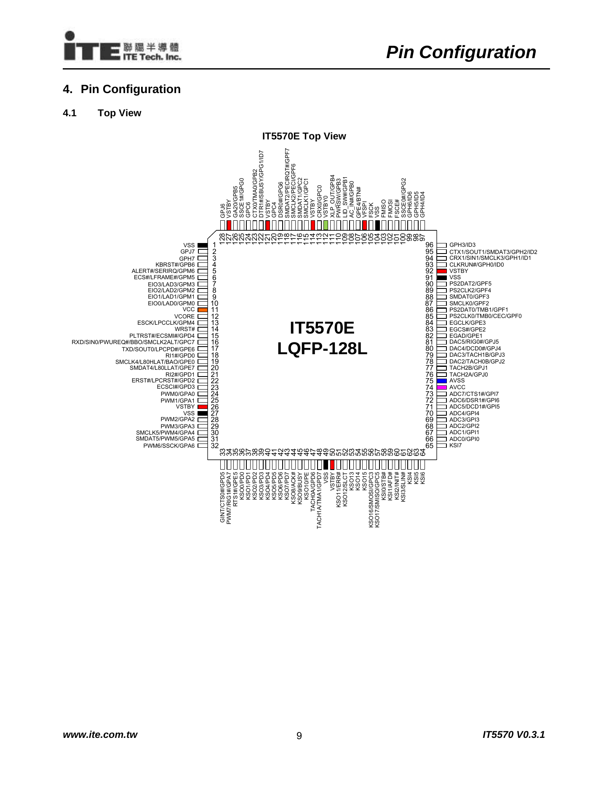
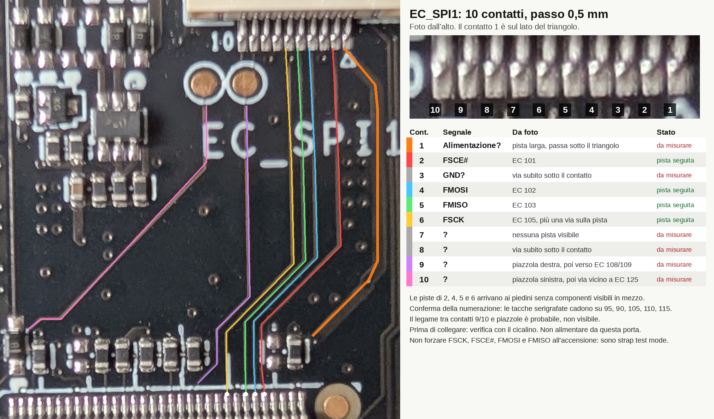
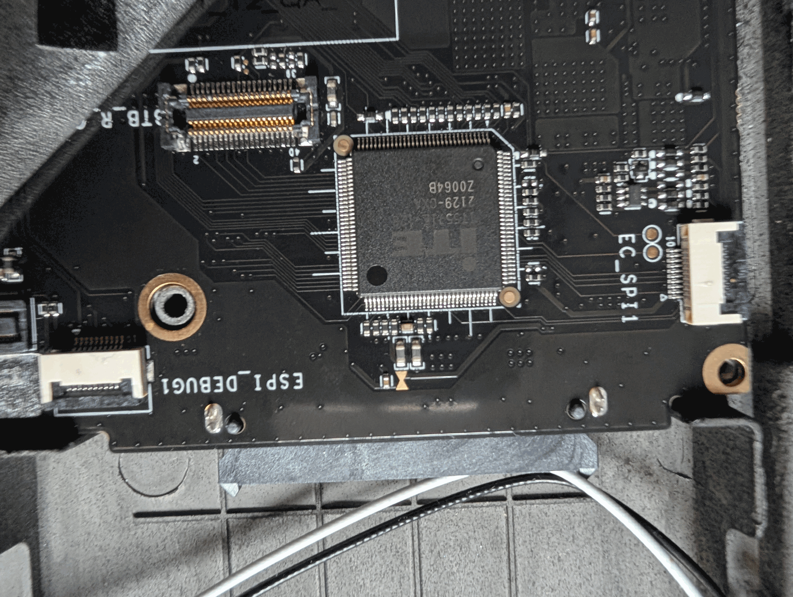

# Parte 5: Studio dell'hardware

Cosa sappiamo della scheda: chip, connettori e piste. Quasi tutto viene da foto, datasheet e firmware: le misure elettriche mancano, e l'elenco è in [6.1](6-modifiche-hardware.md#61-misure-mancanti).

## 5.1 EC

Il chip è un **ITE IT5571 rev. 2**: core **8051**, eFlash embedded da 128 KiB, package **LQFP-128** con piedini (14×14 mm, passo 0,4 mm). È quindi la variante `IT5571E-128`, non la VFBGA. Il package è visto in foto: il marking completo va letto sul chip.

### Piedini dell'EC

Datasheet `IT5571E-128.pdf`, pagina 9, intestata IT5570E. Nelle prime foto (`EC_SPI1` in alto) il chip è orientato come nella figura, con l'angolo smussato del pin 1 in alto a sinistra.

## 5.2 Porta di debug EC_SPI1

**Pinout parziale, ricavato dalle foto del 2026-11-04.** Quattro contatti sono l'interfaccia FSPI dell'EC, gli altri sei restano da misurare. Nessuna misura elettrica è stata fatta.

| Contatto | Segnale | Da dove viene | Stato |
|---|---|---|---|
| 1 | Alimentazione? | Pista larga, il tratto vicino al contatto è coperto dal triangolo | Da misurare |
| 2 | **FSCE#** | EC 101 | Pista seguita |
| 3 | GND? | Via subito sotto il contatto | Da misurare |
| 4 | **FMOSI** | EC 102 | Pista seguita |
| 5 | **FMISO** | EC 103 | Pista seguita |
| 6 | **FSCK** | EC 105, con una via sulla pista | Pista seguita |
| 7 | ? | Nessuna pista visibile | Da misurare |
| 8 | ? | Via subito sotto il contatto | Da misurare |
| 9 | ? | Piazzola dorata destra, poi verso EC 108 o 109 | Da misurare |
| 10 | ? | Piazzola dorata sinistra, poi via vicino a EC 125 | Da misurare |

Il contatto 1 è sul lato del triangolo, il 10 sul lato della serigrafia `10`. Il pinout vale sul connettore della scheda: un cavetto FFC può invertire l'ordine.

**Perché la numerazione è affidabile:**

- Le foto mostrano 32 piedini per lato, quindi un LQFP-128, e un piedino 97 accanto all'angolo in alto a destra.
- Le tacche serigrafate attorno al chip cadono ogni 5 piedini: misurate su 105, 110, 115 in alto e 90, 95 a destra. Solo questa rotazione del chip le fa cadere su multipli di 5.
- Le quattro piste arrivano su posizioni 101, 102, 103 e 105, con un buco sul 104, che è VSS.
- Il datasheet colloca sullo stesso lato FSCE#, FMOSI, FMISO, VSS e FSCK, in quest'ordine.

**Limiti delle foto:**

- I contatti 9 e 10 entrano nelle piazzole sotto la serigrafia: l'abbinamento in tabella è il più probabile, non visibile.
- La pista del contatto 9 sparisce sotto la serigrafia del chip: EC 108 è `AC_IN#`, EC 109 è `LID_SW#`. Nessuno dei due è un segnale di debug.
- La pista larga del contatto 1 arriva a un componente vicino ai piedini 97-100. Un resistore su GPG2 (EC 100) avrebbe senso, perché il datasheet lo vuole in pull-up se FSPI è in uso (Table 5-20). Non è verificato.
- Il lato inferiore della scheda non è stato fotografato: le vie dei contatti 3, 6, 8 e 10 proseguono lì o su strati interni.

**Conseguenze:**

- Nel funzionamento normale FSPI è il bus verso una flash esterna, con l'EC come master: FSCK e FSCE# sono sue uscite (Table 5-5).
- Nessun accesso esterno all'eFlash da FSPI è documentato, ma **non è escluso**.
- **Test mode, punto aperto:** FSCK, FMISO, FMOSI e FSCE# sono anche strap del test mode (Table 5-21), insieme a GPG6 (EC 119) e GPG2 (EC 100). Il datasheet ne cita solo l'ingresso, senza protocollo né funzione. Se i contatti ignoti portassero anche GPG6 e GPG2, il connettore avrebbe tutti gli strap, e una funzione di fabbrica diventerebbe un'ipotesi seria.
- Un programmatore SPI collegato alla cieca non ha un protocollo noto da seguire, e rischia di pilotare linee contro l'EC.
- Il firmware non scrive `FLHCTRL5R` `0x1080`. Il suo unico accesso a `FLHCTRL6R` `0x1081` è a `0xDC22`, non analizzato.
- Ascoltare FSPI non pilota nulla, ma se l'EC legge dall'eFlash queste linee possono restare ferme.
- Da misurare sui contatti 7, 8, 9 e 10: EC 119, EC 100 e i piedini SMBus. Le piste visibili di 9 e 10 non portano a SMBus.

**Dal disegno del produttore:**

- Nello [schema](../refs/img/scheda-porte-debug.png) i connettori **10, 12 e 20** sono "Debug port will be removed in the bulk". Per posizione EC_SPI1 è il **12**, ma sulla scheda fotografata è montato.
- Sulla [scheda assemblata](../refs/img/ec-spi1-assemblato.png) si raggiunge dall'apertura nel telaio. La serigrafia in basso a destra si legge `ESPI_DEBUG1`.

### Cosa può portare

Il datasheet prevede ISP solo via DBGR, su **EPP (pin KBS)** o **SMBus** (sezione 7.23): nessuno dei due è SPI. FSPI è confermata dalle piste, le altre righe valgono solo per i contatti ancora ignoti. Piedini da LQFP-128, Table 4-1.

| Ipotesi | Piedini EC | Indizi da `EC0416` | Se confermata |
|---|---|---|---|
| **FSPI** (flash esterna) | FSCK 105, FSCE# 101, FMOSI 102, FMISO 103, VFSPI 106 | Nessuno: pin dedicati, fuori dalla tabella GPIO | **Confermata per i contatti 2, 4, 5 e 6.** VFSPI non verificato. Nessun accesso esterno all'eFlash descritto |
| **DBGR/SMB** | SMCLK0/SMDAT0 87/88, SMCLK1/SMDAT1 115/116, SMCLK2/SMDAT2 117/118 | Non disabilitato | Il caso utile: ISP e debug ([6.4](6-modifiche-hardware.md#64-lettura-con-dbgrsmb)) |
| **UART** | TXD 17, RXD 16 | Non verificato | Solo console, se il firmware la usa |
| **SSPI** (master verso periferiche) | SSCK 32, SMOSI 56, SMISO 57, SSCE0# 100, SSCE1# 125, SBUSY 122 | Improbabile: nessun accesso a `0x2600-0x2604`, SSCK/SMOSI/SMISO GPIO in uscita, SSCE# in ingresso | Nessun ISP |

**Il firmware non blocca il debug** (analisi statica):

- `KSICTRLR` `0x1D05` riceve `0x04` dalla tabella `0x2564-0x2599`: `OVRPPK=0`, DBGR/EPP attivo. Il codice che carica la tabella non è stato individuato.
- `SLVISELR` `0x1C34` non compare mai: `OVRSMDBG=0`, DBGR/SMB attivo.
- Configurazione dei pin: tabella GPIO `0x2643-0x2777` (103 voci), caricata dal loop a `0xB290`.

**Strumenti:** FT232H per DBGR/SMB e per l'ascolto SPI, se i segnali si raggiungono. L'RP2040 è la scelta per EPP sul connettore tastiera, che non passa da questa porta ([6.3](6-modifiche-hardware.md#63-guida-rp2040-isp-dal-connettore-tastiera)).

## 5.3 Connettore tastiera

Il connettore è il **11** dello [schema del produttore](../refs/img/scheda-porte-debug.png): un board-to-board per tastiera **ThinkPad X201**, 40 contatti su 2 file da 20, passo 0,5 mm. Serigrafia letta da foto: `BTB_R…`. Non è un FPC, quindi una breakout FFC non entra.

Il riferimento è lo [schema dell'adattatore X201](https://github.com/bulat-chu/Thinkpad-X6x-X20x-keyboard-USB-Adapter), che usa il connettore JAE `AA01B-S040VA1`. Nel suo simbolo 41-44 sono a massa: i segnali sono 40. **Descrive la tastiera, non la X210AI.**

- **Numerazione:** contatti pari sulla fila verso l'EC, con `2` a sinistra e `40` a destra (EC a destra del connettore). Il pallino indica il contatto 1 sull'altra fila.
- **Ipotesi di mappa:** `DRVn` della tastiera = `KSOn` dell'EC, `SENSEn` = `KSIn`.
- **Verifica da foto:** le piste di KSO0-KSO4 portano ai contatti 22, 16, 14, 10, 2. Lo schema dà 22, 18, 14, 10, 2. Quattro su cinque coincidono, il KSO1 differisce di un contatto. Per i KSI non c'è nessun riscontro.

| Segnale EC | Pin EC | Contatto | GPIO Pico |
|---|---|---|---|
| KSO0 | 36 | 22 | GP0 |
| KSO1 | 37 | 18 (foto: 16) | GP1 |
| KSO2 | 38 | 14 | GP2 |
| KSO3 | 39 | 10 | GP3 |
| KSO4 | 40 | 2 | GP4 |
| KSO5 | 41 | 4 | GP5 |
| KSO6 | 42 | 8 | GP6 |
| KSO7 | 43 | 12 | GP7 |
| KSI0 | 58 | 5 | GP8 |
| KSI1 | 59 | 13 | GP9 |
| KSI2 | 60 | 9 | GP10 |
| KSI3 | 61 | 7 | GP11 |
| KSI4 | 62 | 11 | GP12 |
| KSI5 | 63 | 3 | GP13 |
| KSO9 | 45 | 20 | GP14 |

**Ogni riga va confermata col cicalino prima di saldare.**

**Da non collegare:** nello schema il 38 è +5 V e il 35 è +3,3 V, il 36 è la massa del tasto Fn (`HOTKEY` sul contatto 1), 31 e 34 sono massa. 37, 39 e 40 sono il TrackPoint a 5 V. Sulla X210AI vanno misurati: l'adattatore fornisce queste alimentazioni da sé.

**Cablaggio di Fn.** Il tasto è un interruttore fuori matrice tra il contatto 1 (`HOTKEY`) e il contatto 36. La nota dello schema dice che sulle X200/X201 il 36 fa da massa per `HOTKEY`, e l'adattatore lo collega a massa con un ponticello: quindi la massa arriva dalla scheda, non dalla tastiera. Servono due collegamenti sulla X210AI:

| Tratto | Fonte | Stato |
|---|---|---|
| Contatto 1 → EC piedino 3 (GPH7) | Firmware e datasheet per il piedino, schema X201 per il contatto | **Confermato dal funzionamento:** col tasto scambiato Fn fisico fa da Ctrl. Il contatto preciso non è misurato |
| Contatto 36 → massa | Schema X201 | **Confermato dal funzionamento**, altrimenti il tasto non si chiuderebbe. Non misurato |
| Pull-up esterno | Il firmware lascia il pull-up interno spento e il tasto funziona | Molto probabile, non visto |

Nelle foto la tacca serigrafata marca il piedino 1, poi 5, 10, 15. I primi due componenti della fila vicino all'angolo (uno scuro, uno color ocra) sono separati dagli altri da due barre di serigrafia e potrebbero essere un filtro RC con pull-up: è solo un'ipotesi.

**Accesso ai contatti:** l'adattatore monta una presa come quella della scheda, quindi non si innesta qui. Serve la spina JAE AA01 a 40 posizioni, il cui codice non è stato trovato, oppure il cavo piatto di una tastiera X201 guasta.

## 5.4 Chip del BIOS

Package **WSON-8** secondo il port coreboot (`board_info.txt` e foto in `Documentation/mainboard/51nb/x210ai.png`, [parte 7](7-coreboot.md)), non SOIC-8 come scritto prima. **Il chip è un Winbond W25Q256JW** (`ef6019`, 32 MiB, **1,8 V**), letto da kernel e `flashrom` sulla scheda il 2026-11-06. Il marking va ancora controllato a vista, insieme alla misura del package. Come programmarlo: [6.5](6-modifiche-hardware.md#65-programmatore-sul-chip-del-bios).

## 5.5 Ventola

Sulla ventola ci sono solo dati dal firmware e dal datasheet: nessuno l'ha ancora guardata sulla scheda.

| Segnale | Piedino EC | Configurazione nel firmware |
|---|---|---|
| PWM0 | 24, GPA0 | `GPCRA0` `0x1610`: uscita all'avvio, poi PWM ([3.1](3-curve-ventola.md#31-il-percorso-nel-firmware)) |
| PWM1 | 25, GPA1 | `GPCRA1` `0x1611`: come PWM0 |
| TACH0A | 47, GPD6 | `GPCRD6` `0x162E` = `0x00`: funzione alternativa, cioè tachimetro |
| TACH1A | 48, GPD7 | `GPCRD7` `0x162F` = `0x00`: come TACH0A |

I tachimetri sono configurati ma il firmware non legge i registri `0x181E-0x1821`, e quei registri non sono nello spazio EC. Per leggere i giri dall'host serve una patch che copi il valore nello spazio EC ([8.5](8-ventole-firmware.md#85-correzioni-proposte-nel-firmware)): il datasheet avverte che la lettura da I2EC non è garantita.

**Non sappiamo:** quante ventole sono collegate (due canali nel firmware, una ventola nello chassis X200/X201), il connettore, se la ventola è a 3 o 4 fili, se il segnale di tachimetro arriva davvero al piedino.
